# 机器人系统与开源硬件

收录开源机器人与硬件项目，重点介绍项目功能、硬件方案、官方代码和复现所需资料，帮助开发者快速找到适合自己的机器人项目。

## 目录

**🆕 本期新增（点项目名直达项目详情）**

  - 🦾 [小楚君灵巧手](#project-xiaochujun-dexterous-hand) — 舵机加拉线模拟肌腱，3D 打印就能做出能抓握的灵巧手
  - 🦾 [RIG-Arm](#project-rig-arm) — 带示教模式的开源机械臂，手动带一遍就能复现动作
  - 🦾 [Dummy-Robot](#project-dummy-robot) — 稚晖君作品，工业机械臂构型压到桌面尺寸，无刷电机直驱
  - 🦾 [RIG-Hover](#project-rig-hover) — 双轮自平衡加机械臂，桌面级的平衡控制演示
  - 🐕 [XGO-Duck](#project-xgoduck) — Arduino UNO Q 驱动的双足机器鸭，四足之外的新形态
  - 🐕 [RIG-Puppy](#project-rig-puppy) — 五个舵机做出一只在桌上跑的小机器狗
  - 🐕 [Open Duck Mini v2](#project-open-duck-mini) — 完整复现的开源双足机器鸭，强化学习步态
  - 🐕 [OpenCat / Bittle X](#project-opencat) — 出货三万多台的机器狗框架，教学与研究都在用
  - 🧍 [PhoneBot](#project-phonebot) — UCLA 把手机变成人形机器人的躯干，算力和感知全交给手机
  - 🧍 [ToddlerBot 2.0](#project-toddlerbot) — 斯坦福的低成本人形，整机可 3D 打印
  - 🧍 [Berkeley Humanoid Lite V1](#project-berkeley-humanoid-lite) — 伯克利的开源人形，执行器设计全部公开
  - 📚 [Learn Arduino](#project-learn-arduino) — 浏览器里就能跑的三维电路仿真，学 Arduino 不用买板子

**🤖 机器人项目（按首字母排序）**
  - [🦾 1. 整机与开源硬件](#硬件整机)
    - [人形机器人](#hardware-humanoid)
    - [四足机器人](#hardware-quadruped)
    - [机械臂与桌面机器人](#hardware-arms)
    - [移动机器人](#hardware-mobile)
  - [👁️ 2. 感知与操作算法](#感知操作)
    - [SLAM 与感知](#algo-slam)
    - [抓取与操作](#algo-grasping)
  - [🧠 3. 具身模型与平台工具链](#模型平台)
    - [具身模型](#model-vla)
    - [平台与工具链](#model-platform)
  - [🛠️ 4. 数据、训练与遥操作](#数据训练)
    - [学习与训练框架](#data-rl)
    - [数据采集与遥操作](#data-teleop)
    - [教程与知识库](#data-tutorial)

   

## 🤖 机器人项目

### 🦾 1. 整机与开源硬件

涵盖人形、四足、机械臂与移动机器人项目及相关硬件资源。

#### 人形机器人

  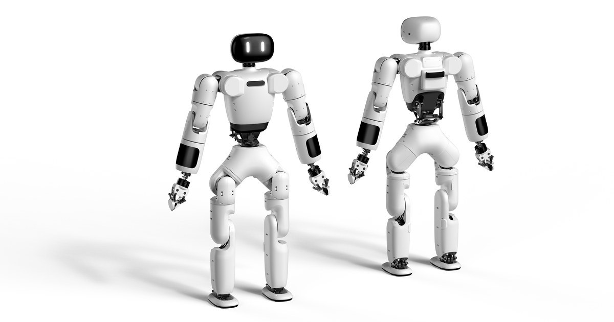

<h3 align="center"><strong>01. AgiBot X1</strong></h3>

<table width="100%">
  <tbody>
    <tr>
      <td><strong>摘要</strong></td>
      <td>智元机器人开源的模块化高自由度人形机器人，以自研 AimRT 中间件为骨架，用强化学习做运动控制，配套提供模型推理、平台驱动、软件仿真三类模块的完整代码。</td>
    </tr>
    <tr>
      <td><strong>特点</strong></td>
      <td>工程化程度较高，推理、驱动、仿真三块拆成独立模块，可以只取其中一块接入自己的系统；中间件用自研 AimRT，支持多语言与多种通信后端，适合作为大型机器人软件架构的学习样本；强化学习控制流程有完整示例，能跑通从仿真训练到实机部署的链路；官方提供开发指南与模块注释，对二次开发比较友好；硬件设计单独放在 agibot_x1_hardware 仓库，软件硬件可以分开跟进。</td>
    </tr>
    <tr>
      <td><strong>硬件 方案</strong></td>
      <td>模块化人形本体，具体关节数量与尺寸以官方硬件仓库 agibot_x1_hardware 为准；软件侧依赖自研 AimRT 中间件，支持 x86 与 ARM 平台。</td>
    </tr>
    <tr>
      <td><strong>GitHub 链接</strong></td>
      <td><a href="https://github.com/AgibotTech/agibot_x1_infer">推理</a> · <a href="https://github.com/AgibotTech/agibot_x1_train">训练</a> · <a href="https://github.com/AgibotTech/agibot_x1_hardware">硬件</a></td>
    </tr>
  </tbody>
</table>

配套资料：<a href="https://aimrt.org/">AimRT 官方文档</a>

  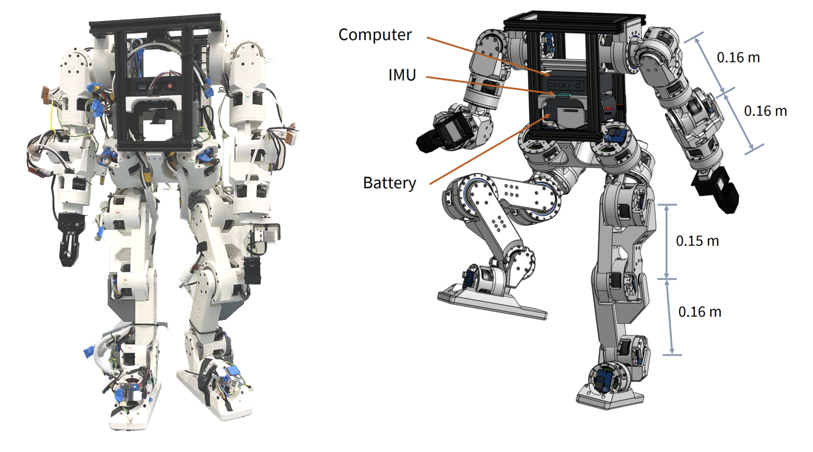

<h3 align="center"><strong>02. Berkeley Humanoid Lite V1</strong></h3>

<table width="100%">
  <tbody>
    <tr>
      <td><strong>摘要</strong></td>
      <td>面向人形机器人研究的开源平台，开放机械结构、执行器设计、底层控制及强化学习工具链，适合学习人形机器人系统集成。</td>
    </tr>
    <tr>
      <td><strong>特点</strong></td>
      <td>支持强化学习驱动的行走与遥操作抓取；开放 CAD、低层控制、机器人模型、Isaac Lab 训练及真机部署相关资料。</td>
    </tr>
    <tr>
      <td><strong>硬件   方案</strong></td>
      <td>无刷电机、模块化 3D 打印摆线减速器、关节电机控制器、CAN 通信总线、IMU 和机载计算平台。V1 的具体执行器及控制器配置以对应版本的 BOM 为准。</td>
    </tr>
    <tr>
      <td><strong>GitHub   链接</strong></td>
      <td><a href="https://github.com/HybridRobotics/Berkeley-Humanoid-Lite">Berkeley Humanoid Lite</a></td>
    </tr>
  </tbody>
</table>

  

<h3 align="center"><strong>03. EngineAI Humanoid</strong></h3>

<table width="100%">
  <tbody>
    <tr>
      <td><strong>摘要</strong></td>
      <td>深圳众擎机器人开源的雙足机器人运动控制算法，基于 MIT Cheetah Software 的腿部控制框架改造，面向 SA01、PM01 等机型提供端到端神经网络拟人步态实现。</td>
    </tr>
    <tr>
      <td><strong>特点</strong></td>
      <td>算法源自 MIT 的 Cheetah Software，属于经过学术验证的腿部控制体系，理解门槛比从零写低得多；代码按 common、config、robot、scripts 等模块拆分，机器人建模、闭链映射等关键算法单独成目录，便于替换或复用；用 LCM 做数据记录与调试，与 MIT 系工具链兼容；工程以 C++ 为主，适合作为双足控制算法的入门参考；官方机型 SA01 与 PM01 有对应的实机验证。</td>
    </tr>
    <tr>
      <td><strong>硬件 方案</strong></td>
      <td>面向众擎 SA01 / PM01 双足机器人；控制算法运行在机器人本体计算单元上，依赖 LCM 通信中间件。</td>
    </tr>
    <tr>
      <td><strong>GitHub 链接</strong></td>
      <td><a href="https://github.com/engineai-robotics/engineai_humanoid">engineai_humanoid</a></td>
    </tr>
  </tbody>
</table>

配套资料：<a href="https://github.com/mit-biomimetics/Cheetah-Software">MIT Cheetah Software</a>

<h3 align="center"><strong>04. Fourier N1</strong></h3>

<table width="100%">
  <tbody>
    <tr>
      <td><strong>摘要</strong></td>
      <td>傅利叶智能开源的人形机器人 N1 项目，提供硬件设计、BOM、装配指南与 Fourier-GRX SDK 等全套资料，是少数把整机图纸开放到零件级别的人形产品。</td>
    </tr>
    <tr>
      <td><strong>特点</strong></td>
      <td>面向 N1 机型开放了结构设计、物料清单与装配流程，按图可以复现出整机；配套 Fourier-GRX SDK 封装了底层运动接口，文档站单独维护，包含安装、运行模式、接口说明与任务示例；硬件与软件资料分开组织，硬件侧适合做结构参考，软件侧适合做控制算法验证；傅利叶在康复机器人与外骨骼方向有多年产品积累，整机的工程可靠性有保障。</td>
    </tr>
    <tr>
      <td><strong>硬件 方案</strong></td>
      <td>傅利叶 N1 人形本体；软件侧通过 Fourier-GRX SDK 接入，SDK 文档站用 Jekyll 维护。</td>
    </tr>
    <tr>
      <td><strong>GitHub 链接</strong></td>
      <td><a href="https://github.com/FFTAI/fourier-grx-N1">fourier-grx-N1 文档</a> · <a href="https://github.com/FFTAI/Wiki-GRx-Pipeline">GRx 开发管线</a></td>
    </tr>
  </tbody>
</table>

配套资料：<a href="https://fftai.github.io/fourier-grx-N1/">Grex 文档站</a>

  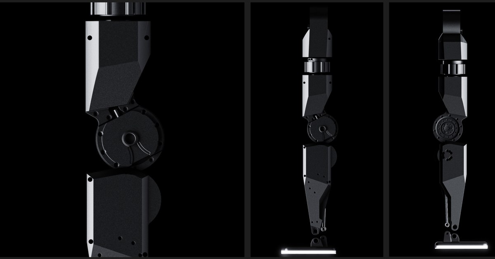

<h3 align="center"><strong>05. K-Bot</strong></h3>

<table width="100%">
  <tbody>
    <tr>
      <td><strong>摘要</strong></td>
      <td>K-Scale Labs 开源的全栈人形机器人平台，目标是让人人都能拥有一台机器人，从机械结构到控制软件整体开放。</td>
    </tr>
    <tr>
      <td><strong>特点</strong></td>
      <td>主打「人人都能拥有」的低成本路线，整机方案按消费级定价设计；代码按子模块组织，用一条命令就能把所有子模块更新到最新 master；项目处于公开 alpha 阶段，官方明确提示会有破坏性变更，适合关注早期形态而不适合直接做产品；提供 Discord 社区、文档站与赏金任务，社区参与度较高；开发者套件即便不满意也支持全额退款，说明官方对可用性有一定信心。</td>
    </tr>
    <tr>
      <td><strong>硬件 方案</strong></td>
      <td>K-Scale Labs 自研人形本体，面向开发者套件销售；控制软件运行在机载计算单元。</td>
    </tr>
    <tr>
      <td><strong>GitHub 链接</strong></td>
      <td><a href="https://github.com/kscalelabs/kbot">K-Bot</a></td>
    </tr>
  </tbody>
</table>

配套资料：<a href="https://url.kscale.dev/docs">官方文档</a> · <a href="https://url.kscale.dev/discord">Discord</a>

  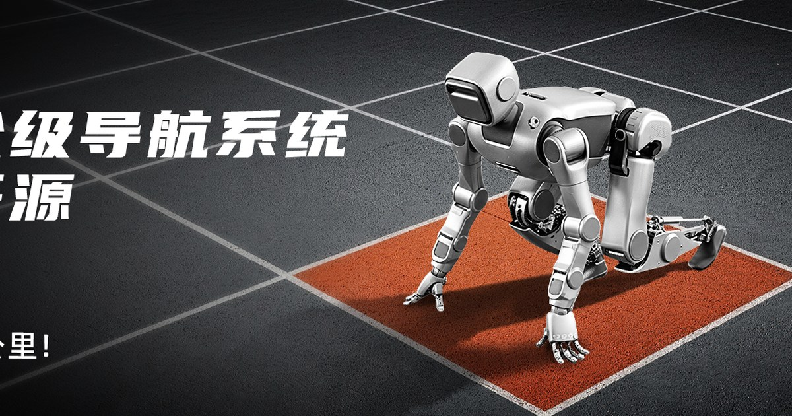

<h3 align="center"><strong>06. OpenLoong 青龙</strong></h3>

<table width="100%">
  <tbody>
    <tr>
      <td><strong>摘要</strong></td>
      <td>人形机器人（上海）有限公司孵化并运营的全栈开源人形机器人项目，按「云端大脑—具身小脑—具身实体—具身数据」四层组织，覆盖从操作系统到本体硬件的完整链路。</td>
    </tr>
    <tr>
      <td><strong>特点</strong></td>
      <td>国内少数由国家队背景企业主导的全栈开源项目，层级划分清晰，每一层都能单独取用；云端大脑层采用多内核设计，可在 Linux 与 LiteOS 之间按设备资源情况选择；具身小脑侧重动力学控制，包含 MPC 与 WBC 等成熟算法栈；硬件设计、训练平台、技能调度框架分别有独立仓库，便于按需跟进；适合做国产人形机器人技术栈的整体性了解。</td>
    </tr>
    <tr>
      <td><strong>硬件 方案</strong></td>
      <td>青龙人形机器人本体，硬件系统单独开放；控制侧基于 MPC + WBC 的动力学算法栈，训练侧有 OpenLoong-Gymloong 平台。</td>
    </tr>
    <tr>
      <td><strong>GitHub 链接</strong></td>
      <td><a href="https://github.com/loongOpen/OpenLoong">OpenLoong</a> · <a href="https://github.com/loongOpen/OpenLoong-Dyn-Control">动力学控制</a> · <a href="https://github.com/loongOpen/OpenLoong-Hardware">硬件系统</a> · <a href="https://github.com/loongOpen/OpenLoong-Gymloong">训练平台</a></td>
    </tr>
  </tbody>
</table>

配套资料：<a href="https://github.com/loongOpen/OpenLoong-Framework">项目框架</a>

  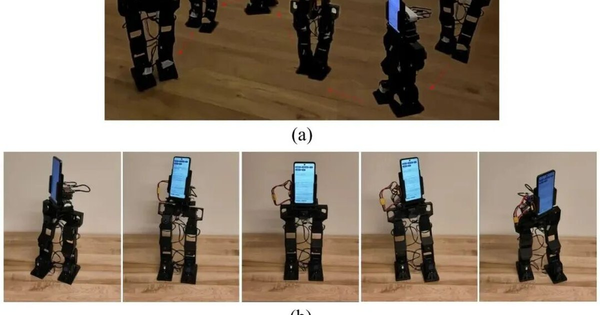

<h3 align="center"><strong>07. PhoneBot</strong></h3>

<table width="100%">
  <tbody>
    <tr>
      <td><strong>摘要</strong></td>
      <td>加州大学洛杉矶分校 RoMeLa 实验室的低成本开源人形机器人，把一部普通 Android 手机当作躯干上的感知、计算与交互中枢，配合 13 个舵机驱动的下半身完成行走与视觉跟随。</td>
    </tr>
    <tr>
      <td><strong>特点</strong></td>
      <td>整机高 48.3 cm、含手机重约 1.8 kg、13 个主动自由度，硬件成本约 400 美元（不含手机）；手机提供相机、IMU、无线连接与板载算力，无需另购感知设备；手机与腿机构之间没有电源线硬连，指令经 Wi-Fi 下发给机载单板机再驱动舵机；行走策略在仿真中用强化学习训练并专门处理舵机力矩上限；展示了双足行走、视觉跟人与从趴地起身。</td>
    </tr>
    <tr>
      <td><strong>硬件   方案</strong></td>
      <td>13 个 DYNAMIXEL XL430-W250-T 舵机、一部普通 Android 手机、机载小型单板机、USB 转 TTL 的 U2D2 接口、3S 锂电池与 DC 转换器、模块化连杆与躯干结构件。当前版本没有手臂。</td>
    </tr>
    <tr>
      <td><strong>GitHub   链接</strong></td>
      <td>暂未核实到可公开访问的官方 GitHub 仓库，官方项目页：<a href="https://phonebot.dev/">phonebot.dev</a></td>
    </tr>
  </tbody>
</table>

配套资料：[论文 arXiv:2610.08737](https://arxiv.org/abs/2610.08737)

  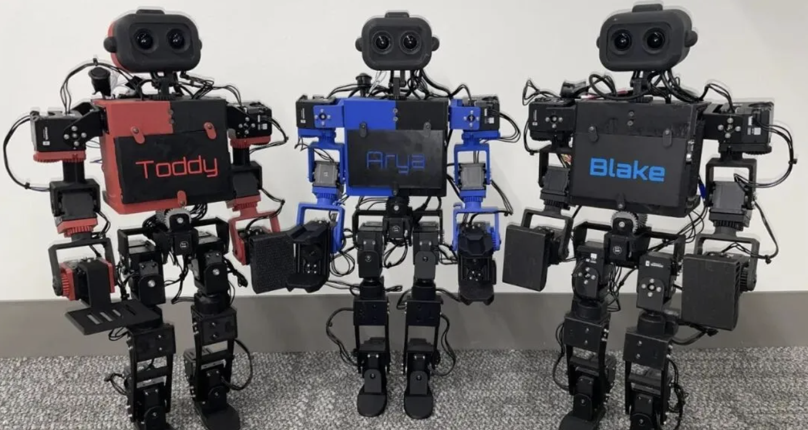

<h3 align="center"><strong>08. ToddlerBot 2.0</strong></h3>

<table width="100%">
  <tbody>
    <tr>
      <td><strong>摘要</strong></td>
      <td>面向机器人学习与全身运动操作研究的开源人形机器人平台，提供仿真、遥操作、强化学习及视觉操作相关工具链。</td>
    </tr>
    <tr>
      <td><strong>特点</strong></td>
      <td>支持全向行走、全身动作及双手操作任务；提供 MuJoCo 仿真、强化学习、关键帧动作、全身遥操作和视觉操作策略，适合研究运动控制与操作能力的结合。</td>
    </tr>
    <tr>
      <td><strong>硬件   方案</strong></td>
      <td>3D 打印结构件、Dynamixel 舵机、Jetson 计算平台、定制电源与通信 PCB、摄像头及相关线束。具体配置按对应版本的官方文档核对。</td>
    </tr>
    <tr>
      <td><strong>GitHub   链接</strong></td>
      <td><a href="https://github.com/hshi74/toddlerbot">ToddlerBot 官方代码与文档</a></td>
    </tr>
  </tbody>
</table>

  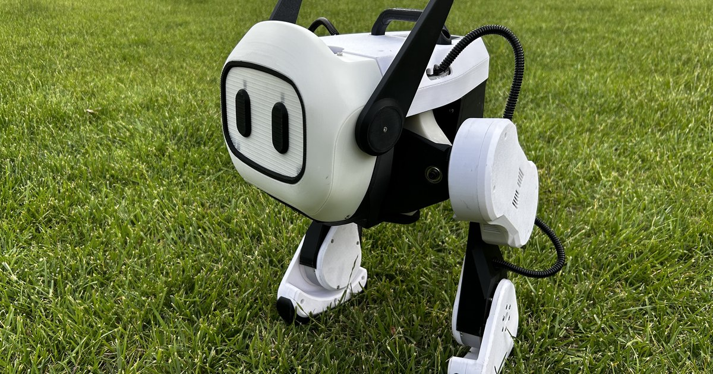

<h3 align="center"><strong>09. Unitree Qmini</strong></h3>

<table width="100%">
  <tbody>
    <tr>
      <td><strong>摘要</strong></td>
      <td>宇树科技开源的低成本双足机器人，所有结构件都能用 3D 打印机做出来，按模块化方式像搭乐高一样快速装配，面向爱好者、教学与研究场景。</td>
    </tr>
    <tr>
      <td><strong>特点</strong></td>
      <td>整机完全开源，从物料清单、电气系统框图到 STEP 结构文件和装配 SOP 全部提供，拿到资料就能下手；定位极低门槛，官方强调是可负担的人形入门平台；结构件全 3D 打印，改设计只需改模型，试错成本低；配套 URDF 模型与 RoboTamer4Qmini 控制框架，装配完就能跑起来；适合作为高校课程设计或机器人竞赛的载体。</td>
    </tr>
    <tr>
      <td><strong>硬件 方案</strong></td>
      <td>全 3D 打印结构件 + 低成本舵机方案；提供完整 BOM、电气框图与 STEP 模型；核心软件栈为 RoboTamer4Qmini。</td>
    </tr>
    <tr>
      <td><strong>GitHub 链接</strong></td>
      <td><a href="https://github.com/unitreerobotics/Qmini">Qmini</a> · <a href="https://github.com/vsislab/RoboTamer4Qmini">控制框架 RoboTamer4Qmini</a></td>
    </tr>
  </tbody>
</table>

配套资料：<a href="https://github.com/unitreerobotics/Qmini/blob/main/Qmini_DIY.pdf">DIY 说明 PDF</a>

#### 四足机器人

<table width="100%">
  <tr>
    <td align="center" width="33%">
      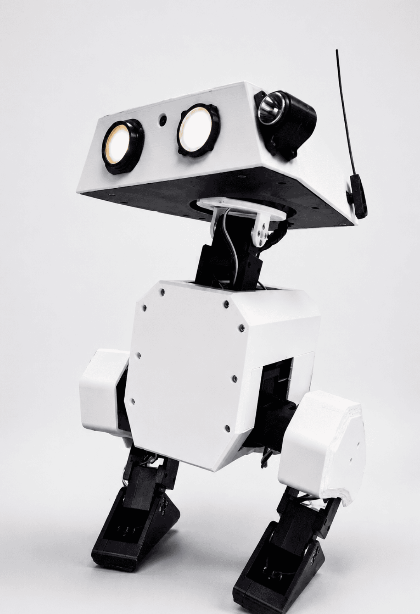
    </td>
    <td align="center" width="33%">
      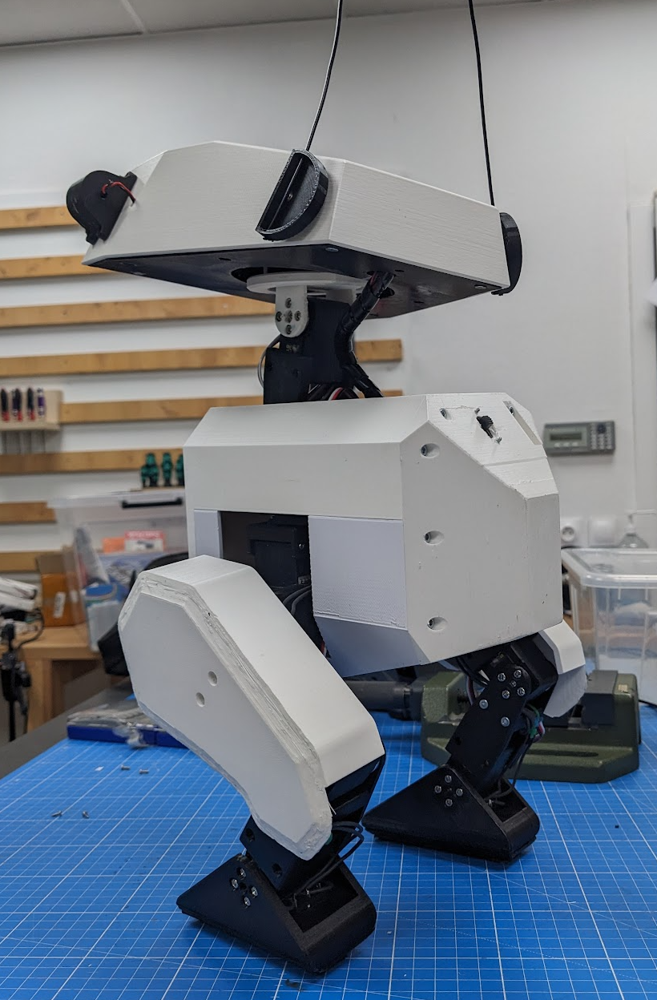
    </td>
    <td align="center" width="33%">
      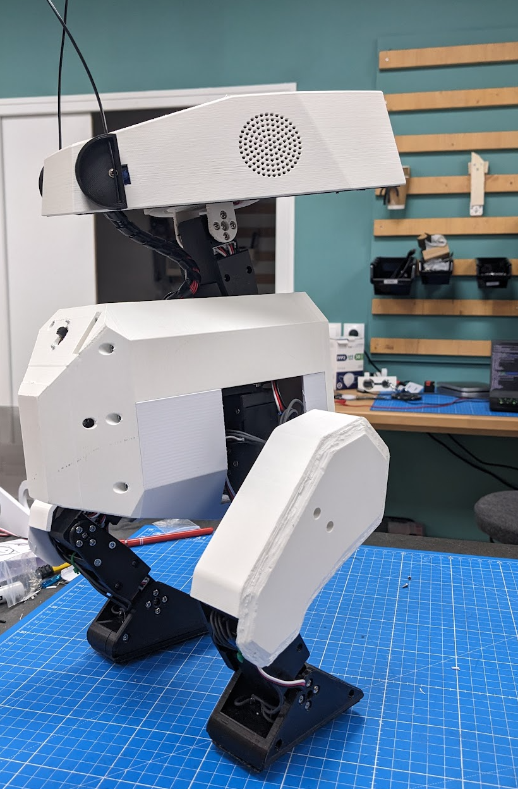
    </td>
  </tr>
</table>

<h3 align="center"><strong>01. Open Duck Mini v2</strong></h3>

<table width="100%">
  <tbody>
    <tr>
      <td><strong>摘要</strong></td>
      <td>面向双足运动与强化学习研究的开源小型机器人，通过仿真训练行走策略，并将策略部署到真实机器人。</td>
    </tr>
    <tr>
      <td><strong>特点</strong></td>
      <td>支持站立、前后移动、左右移动和转向；使用 MuJoCo 相关仿真环境训练行走策略，并通过 ONNX 等部署流程将策略应用于真机，适合学习双足控制和 Sim-to-Real。</td>
    </tr>
    <tr>
      <td><strong>硬件   方案</strong></td>
      <td>3D 打印结构件、串行总线舵机、Raspberry Pi Zero 2 W、IMU、供电系统及线束。完整 BOM 和具体型号以对应版本的官方仓库为准。</td>
    </tr>
    <tr>
      <td><strong>GitHub   链接</strong></td>
      <td><a href="https://github.com/apirrone/Open_Duck_Mini/tree/v2">Open Duck Mini v2</a></td>
    </tr>
  </tbody>
</table>

  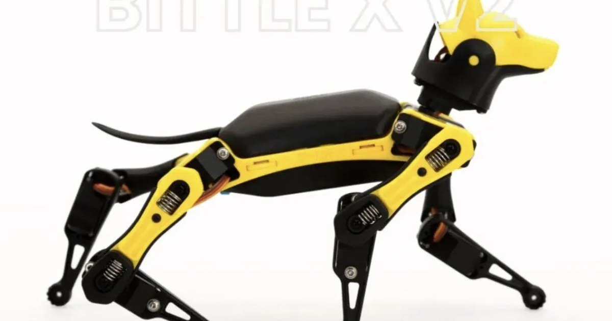

<h3 align="center"><strong>02. OpenCat</strong></h3>

<table width="100%">
  <tbody>
    <tr>
      <td><strong>摘要</strong></td>
      <td>Petoi 开源的四足机器人框架，最初为 Bittle 机器狗与 Nybble 机器猫设计，把步态协调、舵机控制、IMU 融合这些底层难点封装好，让开发者专注在上层应用。</td>
    </tr>
    <tr>
      <td><strong>特点</strong></td>
      <td>老牌项目，累计出货 3 万多台，覆盖 60 多个国家，有 20 多篇学术论文引用，社区与教学资源都很成熟；本仓库对应 NyBoard 平台（ATmega328P），最多可协调 12 个舵机，支持行走、奔跑、跳跃甚至后空翻；当前世代硬件为 Bittle X 与 Nybble Q，代码在 OpenCatESP32 仓库；配套仿真器可以在网页里先试再买；支持传感器扩展包，适合 K12、高校实验室与创客空间做教学。</td>
    </tr>
    <tr>
      <td><strong>硬件 方案</strong></td>
      <td>NyBoard 主控（ATmega328P 定制 Arduino 板），可驱动最多 12 个高性能舵机；当前世代改用 ESP32 / BiBoard；结构件外壳与支架可 3D 打印。</td>
    </tr>
    <tr>
      <td><strong>GitHub 链接</strong></td>
      <td><a href="https://github.com/PetoiCamp/OpenCat">OpenCat</a> · <a href="https://github.com/PetoiCamp/OpenCatEsp32-Quadruped-Robot">OpenCatESP32</a></td>
    </tr>
  </tbody>
</table>

配套资料：<a href="https://www.petoi.com/pages/bittle-x-robot-dog-simulator">Bittle X 仿真器</a>

  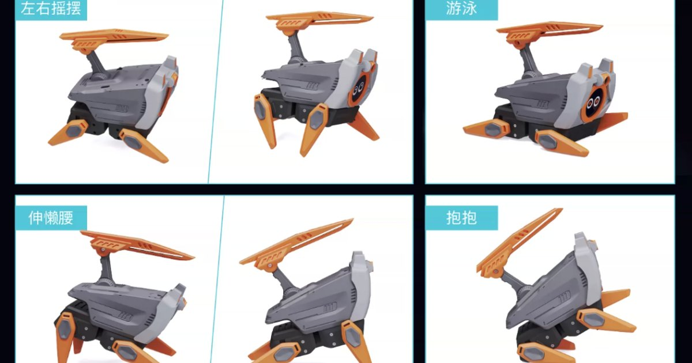

<h3 align="center"><strong>03. RIG-Puppy</strong></h3>

<table width="100%">
  <tbody>
    <tr>
      <td><strong>摘要</strong></td>
      <td>陆吾智能的小狗形态桌面机器人，五个总线舵机配合 ESP32-S3 与圆形屏幕完成摇尾、坐下、起身等动作与表情，支持语音对话与云端大模型智能体。</td>
    </tr>
    <tr>
      <td><strong>特点</strong></td>
      <td>五舵机机器狗形态，内置坐下、起身、摇尾巴等预设动作，头部可随设备倾斜做 IMU 姿态联动；圆形 LCD 播放 20 余种表情动画；语音链路为离线唤醒词加云端 ASR/TTS，接入小智 AI 相关能力并支持智能体个性配置；支持蓝牙配网、OTA 升级与 MCP 工具扩展，可选摄像头；电商有电子配件包与组装整机两种选择。</td>
    </tr>
    <tr>
      <td><strong>硬件   方案</strong></td>
      <td>ESP32-S3（N16R8）、GC9A01 240×240 圆形 LCD、串行总线舵机 ×5、QMI8658C 六轴 IMU、I2S 数字麦克风与功放喇叭、触摸模块、可选 OV2640 摄像头、锂电池与电源管理、3D 打印外壳与腿部结构件。</td>
    </tr>
    <tr>
      <td><strong>GitHub   链接</strong></td>
      <td><a href="https://github.com/LuwuDynamics/rig_omni">LuwuDynamics/rig_omni</a></td>
    </tr>
  </tbody>
</table>

配套资料：[官方 Wiki](https://wiki.xgorobot.com/kb/pet-puppy)

  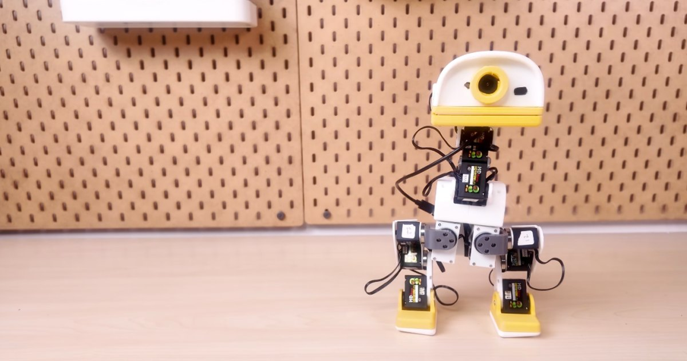

<h3 align="center"><strong>04. XGO-Duck</strong></h3>

<table width="100%">
  <tbody>
    <tr>
      <td><strong>摘要</strong></td>
      <td>陆吾智能基于 Pollen Robotics Microduck 改编的可 3D 打印双足机器鸭，以 Arduino UNO Q 加 15 个串行舵机搭建，配齐结构件、扩展板、装配指南与强化学习训练流程。</td>
    </tr>
    <tr>
      <td><strong>特点</strong></td>
      <td>15 个 Feetech 1910 串行舵机驱动双足，含 4 个颈部/头部关节与一个独立嘴部舵机；Arduino UNO Q 双芯架构，Linux 侧跑策略推理与网页 UI，STM32 侧做舵机与传感器实时通信；自研扩展板集成 IMU 与舵机接口，提供 PCBA 设计文件、Gerber 与 BOM；配套运行时与训练仓库，可在仿真中用强化学习训练行走策略再部署到真机。</td>
    </tr>
    <tr>
      <td><strong>硬件   方案</strong></td>
      <td>Arduino UNO Q（2GB 或 4GB 内存版）、陆吾机器人扩展板（含 IMU 与舵机总线）、Feetech 1910 舵机 15 个、AMP 3 芯舵机线 15 根、8.4V（2S 18650）电池组、8.4V 充电器、轴承与紧固件、3D 打印结构件。完整 BOM 以官方仓库为准。</td>
    </tr>
    <tr>
      <td><strong>GitHub   链接</strong></td>
      <td><a href="https://github.com/LuwuDynamics/xgoduck_hardware">LuwuDynamics/xgoduck_hardware</a> · <a href="https://github.com/LuwuDynamics/xgoduck_runtime_arduino">运行时</a> · <a href="https://github.com/LuwuDynamics/xgoduck_rl">训练</a></td>
    </tr>
  </tbody>
</table>

配套资料：参考 <a href="https://www.arduino.cc/en/software/">Arduino IDE</a>

  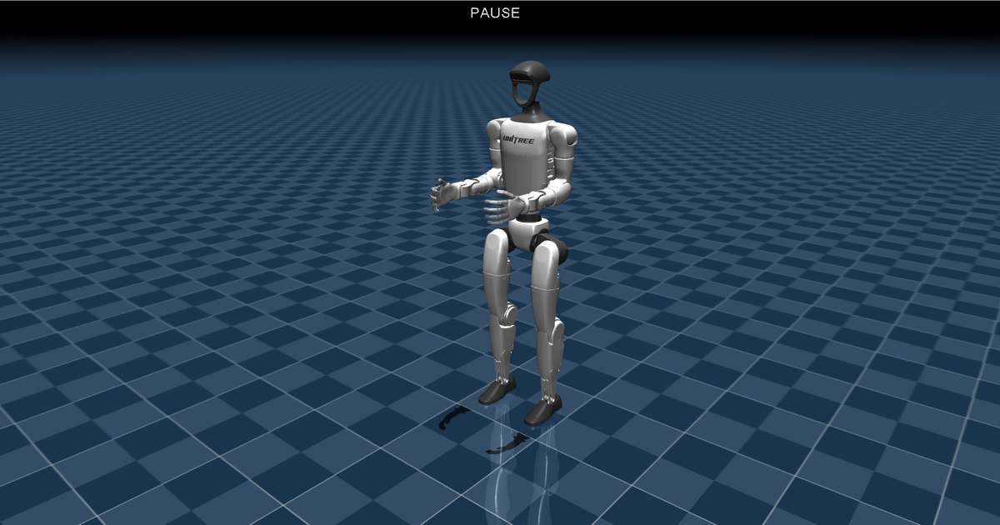

<h3 align="center"><strong>05. 宇树科技四足机器人 ROS</strong></h3>

<table width="100%">
  <tbody>
    <tr>
      <td><strong>摘要</strong></td>
      <td>宇树科技官方的 ROS 仿真与控制软件包，为 A1、Go1、Go2、B1、B2 等主力四足机型提供 Gazebo 仿真模型、关节控制器与实机控制接口。</td>
    </tr>
    <tr>
      <td><strong>特点</strong></td>
      <td>覆盖机型非常全，从 A1、A2、AlienGo、B1、B2、Go1、Go2 到四足新品基本都有对应 description 包，一个仓库解决多机型；每个机型都是独立的 ROS package，包含模型文件、变体配置与 launch 文件，可单独取用；Gazebo 侧支持力矩、位置、角速度等底层关节控制，适合做控制算法验证；需要高层步态控制时配合 unitree_ros_to_real 使用；官方持续维护，与实机 SDK 版本保持同步。</td>
    </tr>
    <tr>
      <td><strong>硬件 方案</strong></td>
      <td>适配宇树 A1 / A2 / AlienGo / B1 / B2 / Go1 / Go2 等四足机型，多为 12 自由度构型；仿真基于 Gazebo，实机控制依赖宇树官方 SDK。</td>
    </tr>
    <tr>
      <td><strong>GitHub 链接</strong></td>
      <td><a href="https://github.com/unitreerobotics/unitree_ros">unitree_ros</a> · <a href="https://github.com/unitreerobotics/unitree_ros_to_real">实机控制包</a></td>
    </tr>
  </tbody>
</table>

  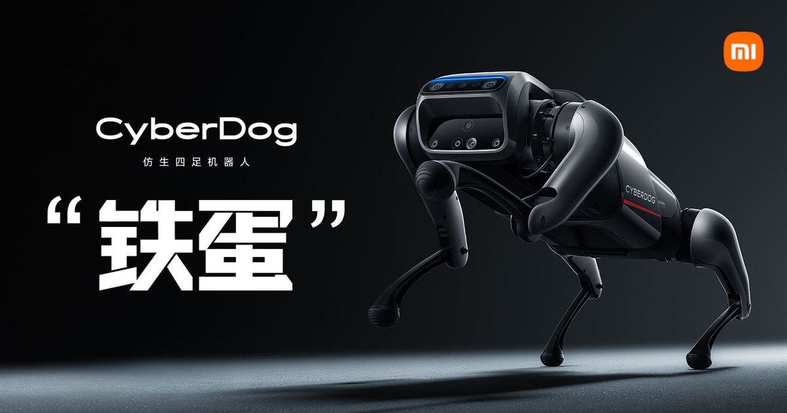

<h3 align="center"><strong>06. 小米 CyberDog</strong></h3>

<table width="100%">
  <tbody>
    <tr>
      <td><strong>摘要</strong></td>
      <td>小米铁蛋四足机器人的 ROS 2 主要功能包合集，基于 ROS 2 实现了多模态感知、自主决策、空间定位、导航与目标追踪等完整应用栈。</td>
    </tr>
    <tr>
      <td><strong>特点</strong></td>
      <td>大厂开源的四足项目，软件栈完整度高，不是单个算法而是整套机器人应用；基于 ROS 2 Galactic 与 Cyclone DDS，并针对 Jetson 平台做了 Ubuntu 18.04 的适配改造，这部分修改单独用 mini.repos 管理，可以参考它怎么把一个发行版裁到嵌入式设备上；功能覆盖多设备连接、多模态感知与交互、自主决策、SLAM 导航与目标追踪；文档分散在子模块根目录，另有 wiki 汇总；默认用户 mi、密码 123，可通过 USB 连接 Download 口后 ssh 登录调试。</td>
    </tr>
    <tr>
      <td><strong>硬件 方案</strong></td>
      <td>小米铁蛋 CyberDog 本体，机载 NVIDIA Jetson 计算平台；中间件为 Cyclone DDS，ROS 2 版本 Galactic。</td>
    </tr>
    <tr>
      <td><strong>GitHub 链接</strong></td>
      <td><a href="https://github.com/MiRoboticsLab/cyberdog_ros2">cyberdog_ros2</a></td>
    </tr>
  </tbody>
</table>

配套资料：<a href="https://github.com/MiRoboticsLab/cyberdog_ros2/wiki">项目 Wiki</a>

#### 机械臂与桌面机器人

  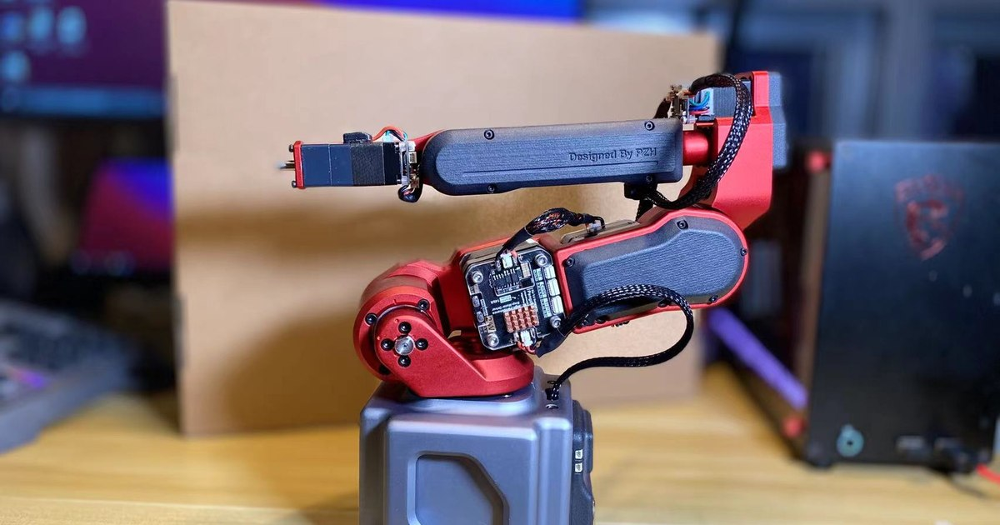

<h3 align="center"><strong>01. Dummy-Robot</strong></h3>

<table width="100%">
  <tbody>
    <tr>
      <td><strong>摘要</strong></td>
      <td>稚晖君（peng-zhihui）开源的超迷你桌面机械臂，用步进电机加减速器驱动，支持正逆解、CAN 总线控制与无线示教器，把工业机械臂那套运动学能力压缩到桌面尺寸。</td>
    </tr>
    <tr>
      <td><strong>特点</strong></td>
      <td>支持关节角到末端位姿的正解与逆解，逆解在 8 组解中取相对上一姿态转角最小的一组；梯形加减速配合 CAN 同步广播，让六个关节同时启动与停止；提供 SEQ 顺序、INT 实时、TRJ 轨迹三种指令模式，分别适配视觉抓取、实时操控与 3D 打印类轨迹任务；核心固件已从 LiteOS 迁到 FreeRTOS，运动学开源，换 DH 参数即可移植到自研机械臂；配套无线示教器 Peak 与上位机 DummyStudio。</td>
    </tr>
    <tr>
      <td><strong>硬件   方案</strong></td>
      <td>原版为铝 CNC 结构加 20/42 步进电机与谐波减速模组，共四块核心电路：REF 核心板、REF 底板、步进电机驱动板与 Peak 示教器；驱动器采用一体闭环加 CAN，每轴只要电源两根与 CAN 两根。官方建议成本敏感者等待「青春版」：结构改 3D 打印、用自制摆线针轮减速器替代谐波减速器，目标整机 2000 元以内。</td>
    </tr>
    <tr>
      <td><strong>GitHub   链接</strong></td>
      <td><a href="https://github.com/peng-zhihui/Dummy-Robot">peng-zhihui/Dummy-Robot</a></td>
    </tr>
  </tbody>
</table>

配套资料：介绍视频在 B 站与 YouTube 搜索「稚晖君 机械臂」

  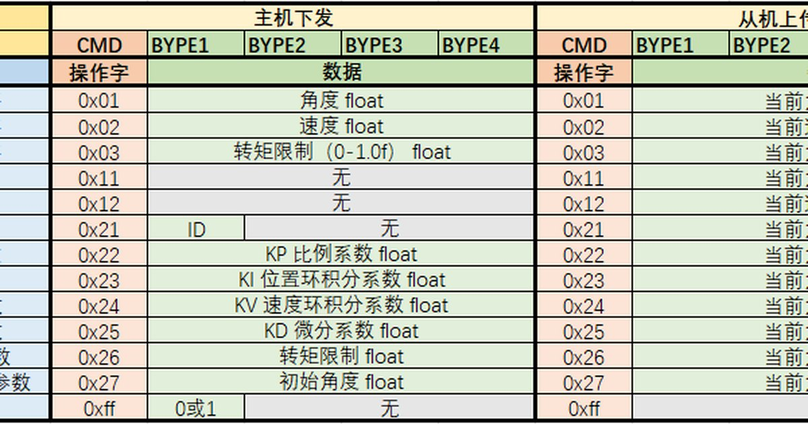

<h3 align="center"><strong>02. ElectronBot 迷你桌面机器人</strong></h3>

<table width="100%">
  <tbody>
    <tr>
      <td><strong>摘要</strong></td>
      <td>稚晖君开源的迷你桌面机器人，两个自由度的机械臂加一块圆形屏幕，可以做出丰富的表情与动作，是桌面级开源硬件的代表作之一。</td>
    </tr>
    <tr>
      <td><strong>特点</strong></td>
      <td>体积小但完整度极高，机械结构、电路、固件、上位机全流程开源；用舵机做驱动，配合圆形 LCD 做表情显示，动作与表情可以联动，观感接近小型机器人宠物；原作者是 B 站知名硬核 UP 主，配套视频讲解完整，社区复现案例非常多；结构件可 3D 打印，PCB 文件可直接打样；适合作为学习机械设计加嵌入式开发的综合项目。</td>
    </tr>
    <tr>
      <td><strong>硬件 方案</strong></td>
      <td>双自由度舵机驱动结构 + 圆形 LCD 显示屏；主控与驱动板一体设计，PCB 文件开源可直接打样；结构件 3D 打印。</td>
    </tr>
    <tr>
      <td><strong>GitHub 链接</strong></td>
      <td><a href="https://github.com/peng-zhihui/ElectronBot">ElectronBot</a></td>
    </tr>
  </tbody>
</table>

配套资料：<a href="https://www.bilibili.com/video/BV1eR4y1w7uj">B 站演示视频</a>

  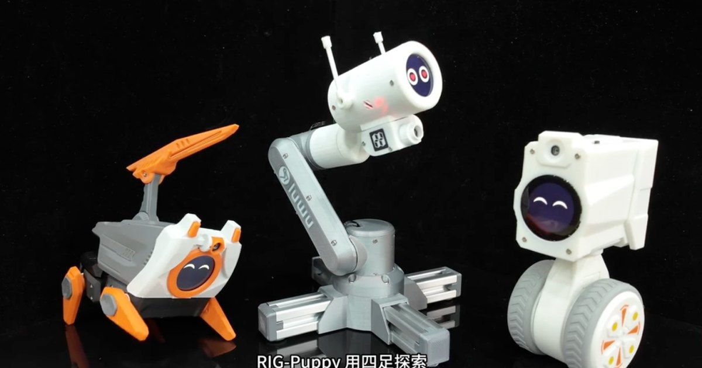

<h3 align="center"><strong>03. RIG-Arm</strong></h3>

<table width="100%">
  <tbody>
    <tr>
      <td><strong>摘要</strong></td>
      <td>陆吾智能的机械臂形态桌面机器人，基于开源 ESP32-S3 固件 RIG-Omni 的 ARM 板型，把机械臂运动、圆屏表情、语音对话与动作交互做进同一个桌面本体。</td>
    </tr>
    <tr>
      <td><strong>特点</strong></td>
      <td>RIG-Omni 同一代码库覆盖 Puppy、Hover、ARM、TARS 四种形态，各板型共享语音、联网与传感器驱动并各自实现运动控制；ARM 板型提供机械臂标定与示教模式，可通过语音或遥控调用动作；圆屏播放表情动画，离线唤醒词本地检测，对话走云端 ASR/TTS；支持蓝牙配网、OTA 升级与 MCP 工具扩展。</td>
    </tr>
    <tr>
      <td><strong>硬件   方案</strong></td>
      <td>ESP32-S3、SCS009 串行总线舵机、QMI8658C 六轴 IMU、GC9A01 240×240 圆形 LCD、I2S 数字麦克风与功放喇叭、触摸模块与按键、锂电池与电源管理、3D 打印结构件。具体配置以官方 BOM 为准。</td>
    </tr>
    <tr>
      <td><strong>GitHub   链接</strong></td>
      <td><a href="https://github.com/LuwuDynamics/rig_omni">LuwuDynamics/rig_omni</a></td>
    </tr>
  </tbody>
</table>

配套资料：[官方 Wiki](https://wiki.xgorobot.com/kb/pet-arm) · [MakerWorld 模型](https://makerworld.com.cn/zh/@LuwuDynamics)

  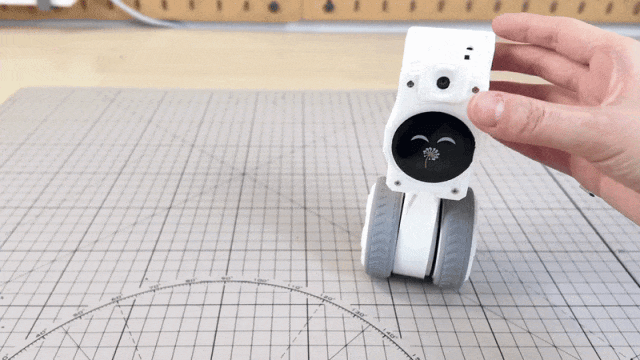

<h3 align="center"><strong>04. RIG-Hover</strong></h3>

<table width="100%">
  <tbody>
    <tr>
      <td><strong>摘要</strong></td>
      <td>基于 ESP32-S3 的开源双轮自平衡桌面机器人，集成运动控制、动态表情、语音交互与视觉感知。</td>
    </tr>
    <tr>
      <td><strong>特点</strong></td>
      <td>支持自平衡、LCD 动态表情、语音交互、人脸检测及蓝牙手柄控制。</td>
    </tr>
    <tr>
      <td><strong>硬件   方案</strong></td>
      <td>ESP32-S3、QMI8658C 六轴 IMU、FOC 无刷电机、圆形 LCD、头部舵机、摄像头、I2S 数字麦克风及 3D 打印外壳。</td>
    </tr>
    <tr>
      <td><strong>GitHub    链接</strong></td>
      <td><a href="https://github.com/LuwuDynamics/rig_omni">LuwuDynamics/rig_omni</a></td>
    </tr>
  </tbody>
</table>

配套资料：[官方文档](https://wiki.xgorobot.com/kb/pet-hover) · [3D 打印模型](https://makerworld.com/en/models/2909205) · [烧录工具](https://tools.luwudynamics.ai)

  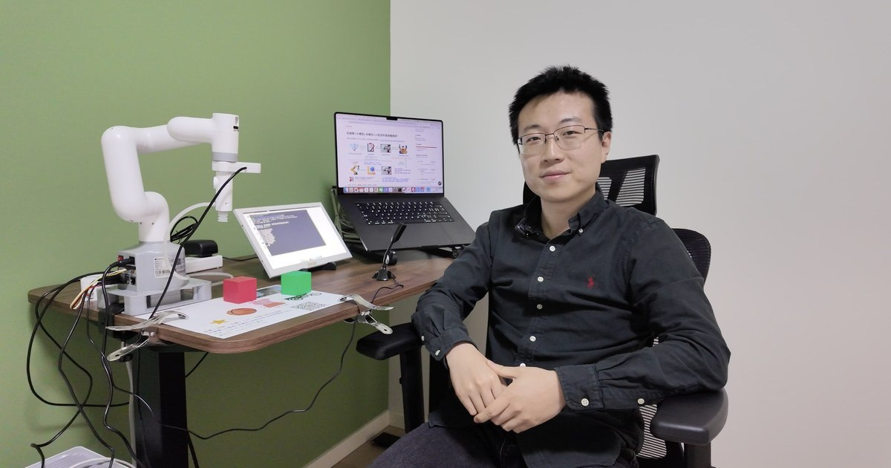

<h3 align="center"><strong>05. vlm_arm</strong></h3>

<table width="100%">
  <tbody>
    <tr>
      <td><strong>摘要</strong></td>
      <td>同济子豪兄开源的多模态机械臂智能体项目，把大语言模型与视觉理解模型接到六轴机械臂上，实现「听得懂人话、看得懂图像、指哪打哪」的人机协作。</td>
    </tr>
    <tr>
      <td><strong>特点</strong></td>
      <td>走的是「大模型当大脑、机械臂当手」的轻量路线，不需要自己训练模型，换 API Key 就能切换不同厂商的大模型；支持 Yi-Large、Claude 3 Opus、文心 4.0 Turbo 等多个 Agent 模型，视觉侧支持 GPT-4v/4o、Yi-Vision、CogVLM2-Grounding、Qwen-VL-Max，方便横向对比各家能力；配套 B 站视频教程与飞书文档，从原理到复现都有讲解；适合作为具身智能入门项目，理解「语言→坐标→动作」这条链路是怎么打通的。</td>
    </tr>
    <tr>
      <td><strong>硬件 方案</strong></td>
      <td>大象机器人 MyCobot 280 Pi 六轴机械臂 + 树莓派 4B（Ubuntu 20.04）；配件包括摄像头法兰与吸泵；需要 Python 3.12 环境。</td>
    </tr>
    <tr>
      <td><strong>GitHub 链接</strong></td>
      <td><a href="https://github.com/TommyZihao/vlm_arm">vlm_arm</a></td>
    </tr>
  </tbody>
</table>

配套资料：<a href="https://www.bilibili.com/video/BV1Cn4y1R7V2">原理讲解视频</a> · <a href="https://njapov1vnz.feishu.cn/docx/Qosedmc5NoYK7IxVoMBcD47jn9b">复现教程（飞书）</a>

  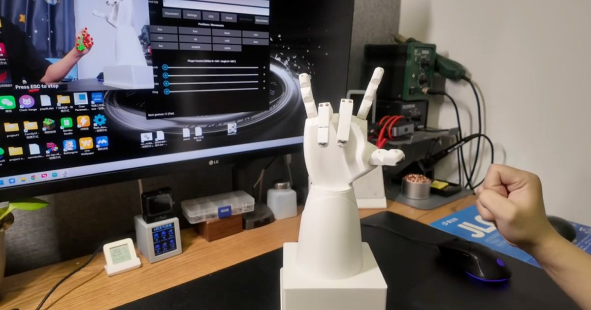

<h3 align="center"><strong>06. 小楚君灵巧手</strong></h3>

<table width="100%">
  <tbody>
    <tr>
      <td><strong>摘要</strong></td>
      <td>以舵机为动力、用线绳模拟肌腱拉动手指的 3D 打印机械手，可完成张开、握拳与抓握动作，并配套手机控制 App，是低成本观察线控结构的入门项目。</td>
    </tr>
    <tr>
      <td><strong>特点</strong></td>
      <td>用普通舵机提供动力，再通过拉线带动 3D 打印手指弯曲，不必每个关节都配独立电机；可完成张开、握拳、抓握等基本动作，适合观察「一个舵机通过绳索驱动多个关节」的欠驱动思路；配套手机 App 用于手动控制与动作演示；作者在视频平台以「小楚君CC」发布教程，资料与 App 通过网盘分发。</td>
    </tr>
    <tr>
      <td><strong>硬件   方案</strong></td>
      <td>3D 打印手掌与手指结构件、驱动舵机若干、线绳与线管、主控板、供电电池与开关、紧固件与轴承。官方未公布完整物料清单，具体型号与数量以作者资料为准。</td>
    </tr>
    <tr>
      <td><strong>GitHub   链接</strong></td>
      <td>暂未核实到官方 GitHub 仓库，资料以作者网盘发布：<a href="https://pan.baidu.com/s/1QT5dh-R3a37De9sv_LerFw?pwd=xesd">开源资料（提取码 xesd）</a> · <a href="https://pan.baidu.com/s/1nbod7cnuJ4-DOrkbAUGfgA?pwd=12as">手机 App（提取码 12as）</a></td>
    </tr>
  </tbody>
</table>

配套资料：视频教程在各大平台搜索「小楚君CC」

#### 移动机器人

  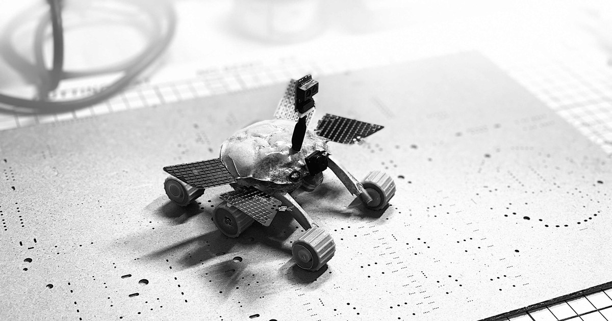

<h3 align="center"><strong>01. MiniRover 火星车</strong></h3>

<table width="100%">
  <tbody>
    <tr>
      <td><strong>摘要</strong></td>
      <td>稚晖君开源的迷你火星车项目，ESP32 主控配摄像头与 ToF 传感器，可通过 WiFi 图传和手机 App 遥控，硬件与固件全部开放。</td>
    </tr>
    <tr>
      <td><strong>特点</strong></td>
      <td>硬件资料完整度高，原理图与 PCB 用 Altium Designer 打开，release 目录里直接给了 Gerber 文件，发给厂家就能打样；ESP32 固件包含摄像头驱动、JPEG 流式 Web 服务器、电机驱动与 ToF 的 ADC 读取，是一份完整的嵌入式案例；附带 Android 示例代码，演示怎么通过 WiFi 与 ESP32 通信并显示图传；Docs 目录里有相关芯片的数据手册，不用另外找；适合作为移动机器人入门的第一台车。</td>
    </tr>
    <tr>
      <td><strong>硬件 方案</strong></td>
      <td>ESP32 主控，集成摄像头驱动、JPEG 流式 Web 服务器、电机驱动与 ToF 传感器 ADC 读取；PCB 开源可直接打样。</td>
    </tr>
    <tr>
      <td><strong>GitHub 链接</strong></td>
      <td><a href="https://github.com/peng-zhihui/MiniRover-Hardware">MiniRover-Hardware</a></td>
    </tr>
  </tbody>
</table>

配套资料：<a href="https://www.bilibili.com/video/BV1ZA411e7Ff">B 站演示视频</a>

  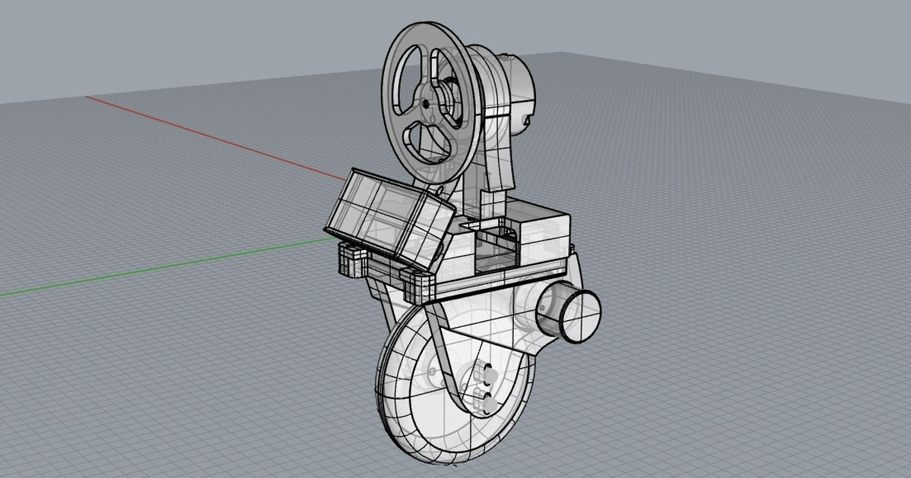

<h3 align="center"><strong>02. ONE-Robot 独轮机器人</strong></h3>

<table width="100%">
  <tbody>
    <tr>
      <td><strong>摘要</strong></td>
      <td>稚晖君 2015 年做的独轮自平衡机器人，基于 IMU 与 STM32 实现姿态解算与平衡控制，是自平衡控制里结构最简单、最容易理解的一个形态。</td>
    </tr>
    <tr>
      <td><strong>特点</strong></td>
      <td>只有一个轮子，平衡逻辑却比两轮更纯粹，是理解倒立摆与姿态闭环控制的好载体；仓库包含 STM32 固件源码与机械结构 3D 模型；控制板电路因年代久远已丢失，但作者说明电路很简单，可自行参照固件引脚定义复刻；项目时间较早，技术栈偏基础，适合想从零理解自平衡原理的人。</td>
    </tr>
    <tr>
      <td><strong>硬件 方案</strong></td>
      <td>STM32 主控 + IMU 姿态传感器 + 单个驱动轮；控制板电路未公开（作者说明结构简单可自行复刻），机械结构提供 3D 模型。</td>
    </tr>
    <tr>
      <td><strong>GitHub 链接</strong></td>
      <td><a href="https://github.com/peng-zhihui/ONE-Robot">ONE-Robot</a></td>
    </tr>
  </tbody>
</table>

配套资料：<a href="https://www.bilibili.com/video/av89252261/">B 站演示视频</a>

---

### 👁️ 2. 感知与操作算法

涵盖 SLAM、多传感器融合、视觉感知、抓取算法及相关传感器资源。

#### SLAM 与感知

  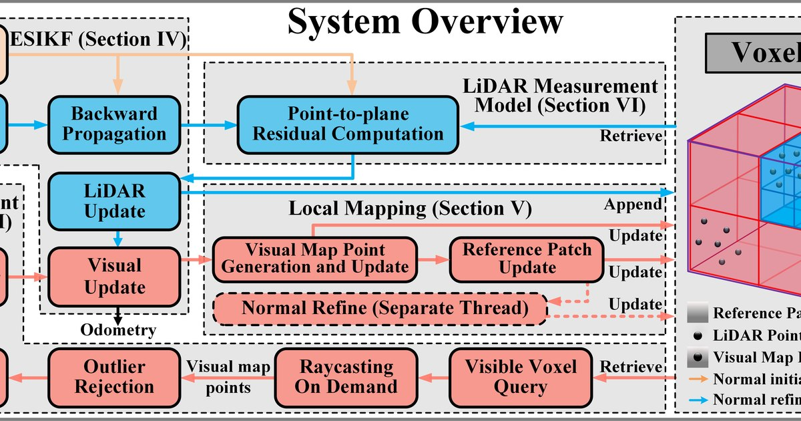

<h3 align="center"><strong>01. FAST-LIVO2</strong></h3>

<table width="100%">
  <tbody>
    <tr>
      <td><strong>摘要</strong></td>
      <td>香港大学 MARS 实验室开发的快速直接法激光惯性视觉里程计，把 LiDAR、IMU 与相机紧耦合在一个统一的 ESIKF 框架里，实时输出高精度位姿与着色点云地图。</td>
    </tr>
    <tr>
      <td><strong>特点</strong></td>
      <td>采用直接法而非特征法，图像部分不做特征提取与匹配，在纹理弱、重复纹理场景里更稳；ESIKF（误差状态迭代卡尔曼滤波）统一处理三种传感器的观测，耦合程度比松耦合方案高；速度与精度兼顾，论文被 T-RO 2024 接收，学术认可度高；官方开源代码与数据集齐全，FAST-LIVO 系列已在多个后续工作中被作为基线对比。</td>
    </tr>
    <tr>
      <td><strong>硬件 方案</strong></td>
      <td>需要 LiDAR + IMU + 相机的硬件组合；代码基于 ROS，依赖 PCL、Eigen、Sophus 等常见库。</td>
    </tr>
    <tr>
      <td><strong>GitHub 链接</strong></td>
      <td><a href="https://github.com/hku-mars/FAST-LIVO2">FAST-LIVO2</a></td>
    </tr>
  </tbody>
</table>

配套资料：<a href="https://arxiv.org/abs/2408.14035">项目主页</a>

  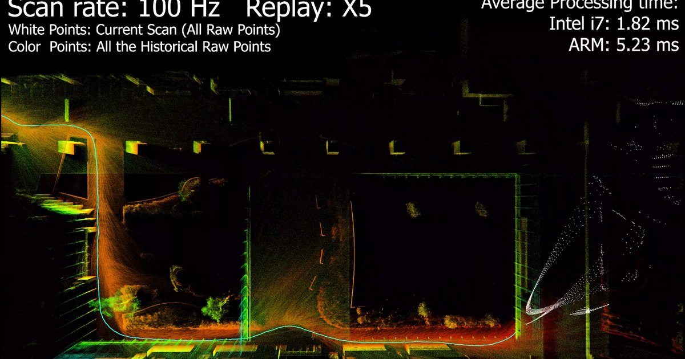

<h3 align="center"><strong>02. FAST_LIO</strong></h3>

<table width="100%">
  <tbody>
    <tr>
      <td><strong>摘要</strong></td>
      <td>香港大学 MARS 实验室的激光惯性里程计，用紧耦合的迭代卡尔曼滤波处理 LiDAR 与 IMU 数据，靠自研 ikd-Tree 数据结构做到实时运行。</td>
    </tr>
    <tr>
      <td><strong>特点</strong></td>
      <td>核心是 ikd-Tree——一个支持增量更新的动态 KD 树，相比静态 KD 树在点云频繁增删的场景下效率高很多，这个数据结构也被单独开源供其他项目复用；紧耦合的 ESIKF 框架在处理高速运动与稀疏特征时表现稳定；计算量小，在普通机载计算单元上就能实时跑；生态成熟，衍生出 FAST-LIO-LOCALIZATION 重定位版本、LI_Init 外参初始化包、FAST-LIVO 系列等一整套工具链。</td>
    </tr>
    <tr>
      <td><strong>硬件 方案</strong></td>
      <td>需要 LiDAR + IMU；代码基于 ROS，能在低算力平台实时运行。</td>
    </tr>
    <tr>
      <td><strong>GitHub 链接</strong></td>
      <td><a href="https://github.com/hku-mars/FAST_LIO">FAST_LIO</a> · <a href="https://github.com/hku-mars/ikd-Tree">ikd-Tree</a></td>
    </tr>
  </tbody>
</table>

配套资料：<a href="https://github.com/hku-mars/LiDAR_IMU_Init">外参初始化 LI_Init</a>

  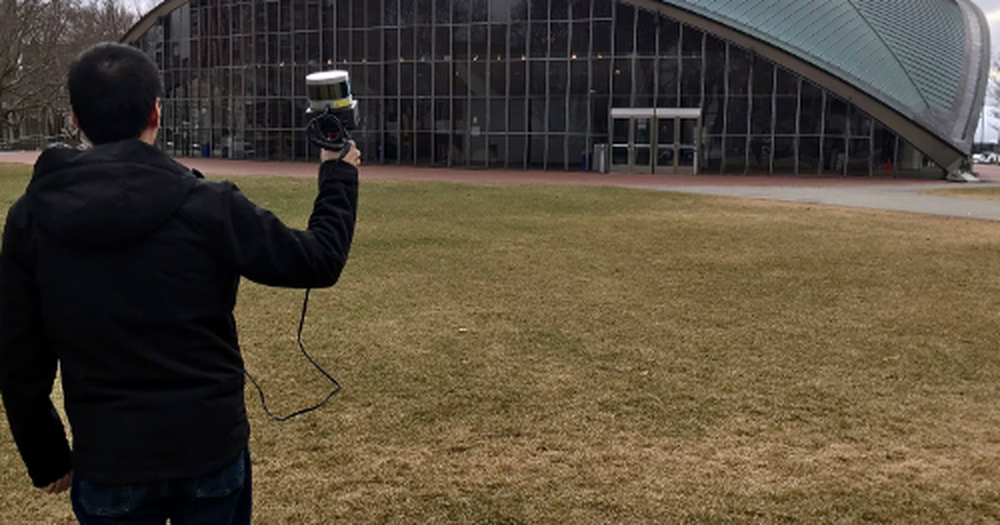

<h3 align="center"><strong>03. LIO-SAM</strong></h3>

<table width="100%">
  <tbody>
    <tr>
      <td><strong>摘要</strong></td>
      <td>基于因子图优化的激光惯性里程计，把 LiDAR 与 IMU 的观测作为因子加入图优化，配合 IMU 预积分与回环检测，输出平滑的位姿轨迹与点云地图。</td>
    </tr>
    <tr>
      <td><strong>特点</strong></td>
      <td>走的是优化路线而不是滤波路线，因子图框架让回环约束、GPS 因子、外参都可以统一加进图里，扩展性好；IMU 预积分配合激光里程计做高频与低频两级估计，兼顾实时性与精度；社区活跃度高，衍生出大量适配不同雷达的 fork，常见雷达基本都能找到现成配置；官方建议先跑通提供的数据包再上实车，文档里有对应的调试指引；是激光 SLAM 方向最常见的对照基线之一。</td>
    </tr>
    <tr>
      <td><strong>硬件 方案</strong></td>
      <td>需要 3D LiDAR + 9 轴 IMU；代码基于 ROS，也可选接入 GPS 做全局约束。</td>
    </tr>
    <tr>
      <td><strong>GitHub 链接</strong></td>
      <td><a href="https://github.com/TixiaoShan/LIO-SAM">LIO-SAM</a></td>
    </tr>
  </tbody>
</table>

配套资料：<a href="https://github.com/TixiaoShan/LIO-SAM">作者说明文档</a>

  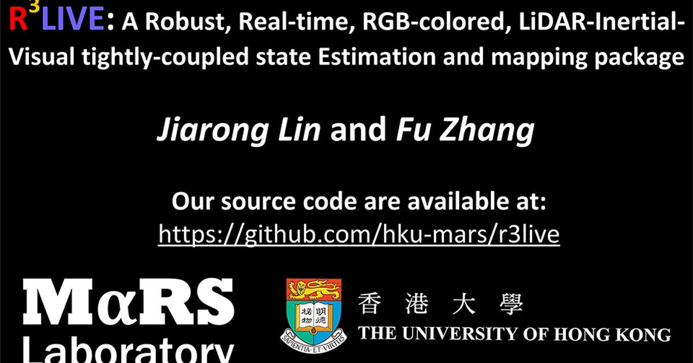

<h3 align="center"><strong>04. R3LIVE</strong></h3>

<table width="100%">
  <tbody>
    <tr>
      <td><strong>摘要</strong></td>
      <td>香港大学 MARS 实验室的激光惯性视觉紧耦合状态估计与建图框架，同时维护几何地图与纹理地图，输出的点云自带 RGB 颜色。</td>
    </tr>
    <tr>
      <td><strong>特点</strong></td>
      <td>同时构建两份地图——由 LiDAR 主导的几何结构和由相机主导的纹理颜色，最终合成有色点云，看着比纯几何地图直观得多；LIO 与 VIO 子系统各自独立又相互约束，单传感器短暂失效时鲁棒性更好；论文被 ICRA 2022 接收；采用 GPLv2 许可，个人与学术用途免费；适合做需要彩色地图的重建类任务。</td>
    </tr>
    <tr>
      <td><strong>硬件 方案</strong></td>
      <td>需要 LiDAR + IMU + 相机；代码基于 ROS。</td>
    </tr>
    <tr>
      <td><strong>GitHub 链接</strong></td>
      <td><a href="https://github.com/hku-mars/r3live">R3LIVE</a></td>
    </tr>
  </tbody>
</table>

  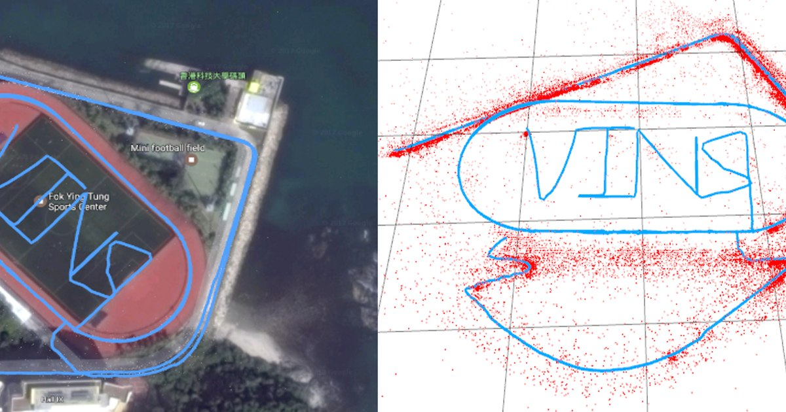

<h3 align="center"><strong>05. VINS-Fusion</strong></h3>

<table width="100%">
  <tbody>
    <tr>
      <td><strong>摘要</strong></td>
      <td>香港科技大学开源的基于优化的多传感器状态估计器，支持单目、双目、双目加 IMU 等多种组合，为无人机、车辆、机器人提供高精度自定位。</td>
    </tr>
    <tr>
      <td><strong>特点</strong></td>
      <td>VINS-Mono 的扩展版，传感器组合从单目加 IMU 扩展到双目、双目加 IMU，甚至可接入 GPS 做全局融合；整个估计器基于滑动窗口优化，把视觉重投影误差与 IMU 预积分误差一起优化，精度与鲁棒性在同类中属于第一梯队；KITTI 等公开数据集上有现成对比结果；代码结构清晰，是很多视觉惯导工作的基线，学术界引用量非常高。</td>
    </tr>
    <tr>
      <td><strong>硬件 方案</strong></td>
      <td>支持单目 / 双目相机 + IMU 组合，可选接入 GPS；代码基于 ROS。</td>
    </tr>
    <tr>
      <td><strong>GitHub 链接</strong></td>
      <td><a href="https://github.com/HKUST-Aerial-Robotics/VINS-Fusion">VINS-Fusion</a></td>
    </tr>
  </tbody>
</table>

  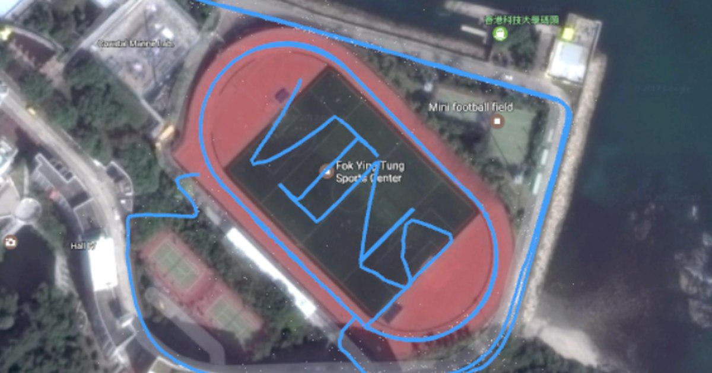

<h3 align="center"><strong>06. VINS-Mono</strong></h3>

<table width="100%">
  <tbody>
    <tr>
      <td><strong>摘要</strong></td>
      <td>香港科技大学的单目视觉惯性状态估计器，用紧耦合的滑动窗口优化把相机与 IMU 融合，是视觉惯导 SLAM 方向上引用量最高的开源工作之一。</td>
    </tr>
    <tr>
      <td><strong>特点</strong></td>
      <td>后续加入了地图合并、位姿图复用、在线时间标定与卷帘快门相机支持，功能在同代方案里相当完整；紧耦合优化的架构成为此后大量 VINS 系列工作的基础；提供完整数据集与详细文档，复现门槛低；基于此扩展出的 VINS-Fusion 支持更多传感器组合，可根据需要选择；在无人机与移动机器人自定位场景里应用广泛。</td>
    </tr>
    <tr>
      <td><strong>硬件 方案</strong></td>
      <td>单目相机 + IMU；代码基于 ROS，依赖 Ceres、OpenCV 等库。</td>
    </tr>
    <tr>
      <td><strong>GitHub 链接</strong></td>
      <td><a href="https://github.com/HKUST-Aerial-Robotics/VINS-Mono">VINS-Mono</a></td>
    </tr>
  </tbody>
</table>

  

<h3 align="center"><strong>07. 宇树科技 4D LiDAR SLAM</strong></h3>

<table width="100%">
  <tbody>
    <tr>
      <td><strong>摘要</strong></td>
      <td>宇树把 Point-LIO 激光惯性里程计算法适配到自家 L1、L2 两款 4D 激光雷达上的开源实现，开箱即可跑通。</td>
    </tr>
    <tr>
      <td><strong>特点</strong></td>
      <td>Point-LIO 本身是点级更新的紧耦合激光惯性里程计，对剧烈运动与稀疏几何场景的适应性较好；宇树做了官方适配，省去了自己标定外参、调参数的时间，拿到 L1 或 L2 雷达就能直接运行；两款雷达都是 4D 规格，同时输出距离与反射率等信息；适合已经使用宇树雷达、想快速搭起定位链路的用户。</td>
    </tr>
    <tr>
      <td><strong>硬件 方案</strong></td>
      <td>宇树 LiDAR L1 或 L2 4D 激光雷达 + IMU；代码基于 ROS。</td>
    </tr>
    <tr>
      <td><strong>GitHub 链接</strong></td>
      <td><a href="https://github.com/unitreerobotics/point_lio_unilidar">point_lio_unilidar</a></td>
    </tr>
  </tbody>
</table>

  

<h3 align="center"><strong>08. 视觉 SLAM 十四讲</strong></h3>

<table width="100%">
  <tbody>
    <tr>
      <td><strong>摘要</strong></td>
      <td>高翔（gaoxiang12）编写的《视觉 SLAM 十四讲》配套代码库，从数学基础讲到完整的视觉里程计与后端优化实现，是中文圈视觉 SLAM 最主流的入门教材。</td>
    </tr>
    <tr>
      <td><strong>特点</strong></td>
      <td>书与代码一一对应，每一讲都有可运行的示例程序，跟着敲一遍就能把理论落到代码上；覆盖范围完整，从三维空间刚体运动、李群李代数、相机模型，到特征点法、直接法、后端优化、回环检测与建图；使用 Eigen、Sophus、Ceres、g2o 等主流库，学完等于顺带熟悉了这套工具链；第一版与第二版代码都保留，勘误持续在本仓库更新；英文版正在翻译中，另有百度网盘备份方便国内访问。</td>
    </tr>
    <tr>
      <td><strong>硬件 方案</strong></td>
      <td>无特定硬件要求，纯软件学习项目；依赖 Eigen、Sophus、OpenCV、Ceres、g2o、Pangolin 等常见库。</td>
    </tr>
    <tr>
      <td><strong>GitHub 链接</strong></td>
      <td><a href="https://github.com/gaoxiang12/slambook2">slambook2</a> · <a href="https://github.com/gaoxiang12/slambook">第一版代码</a></td>
    </tr>
  </tbody>
</table>

配套资料：<a href="https://book.douban.com/subject/27028215/">豆瓣书评页</a>

#### 抓取与操作

<h3 align="center"><strong>01. AnyGrasp</strong></h3>

<table width="100%">
  <tbody>
    <tr>
      <td><strong>摘要</strong></td>
      <td>上海交通大学与上海人工智能实验室开源的通用抓取检测与跟踪 SDK，能在任意物体、任意姿态下输出可执行的 6-DoF 抓取位姿，并支持抓取过程中的实时跟踪。</td>
    </tr>
    <tr>
      <td><strong>特点</strong></td>
      <td>不限定物体类别，对未见过的物体也能给出抓取建议，泛化能力比早期的专用抓取检测器强；同时支持抓取检测与抓取跟踪，抓取过程中手部移动时仍能持续修正目标；输出的是完整 6-DoF 位姿，可直接下发给机械臂执行；配套 GraspNet 数据集与 graspnetAPI 工具链，检测、评估、可视化都有现成工具；论文与项目页资料齐全，是抓取方向常用的对照方案。</td>
    </tr>
    <tr>
      <td><strong>硬件 方案</strong></td>
      <td>需要 RGB-D 相机提供深度与彩色图；SDK 提供 Python 接口，依赖 PyTorch 与 CUDA 环境。</td>
    </tr>
    <tr>
      <td><strong>GitHub 链接</strong></td>
      <td><a href="https://github.com/graspnet/anygrasp_sdk">anygrasp_sdk</a> · <a href="https://github.com/graspnet/graspnetAPI">graspnetAPI</a></td>
    </tr>
  </tbody>
</table>

配套资料：<a href="https://graspnet.net/anygrasp.html">项目主页</a> · <a href="https://arxiv.org/abs/2212.08333">arXiv 论文</a>

  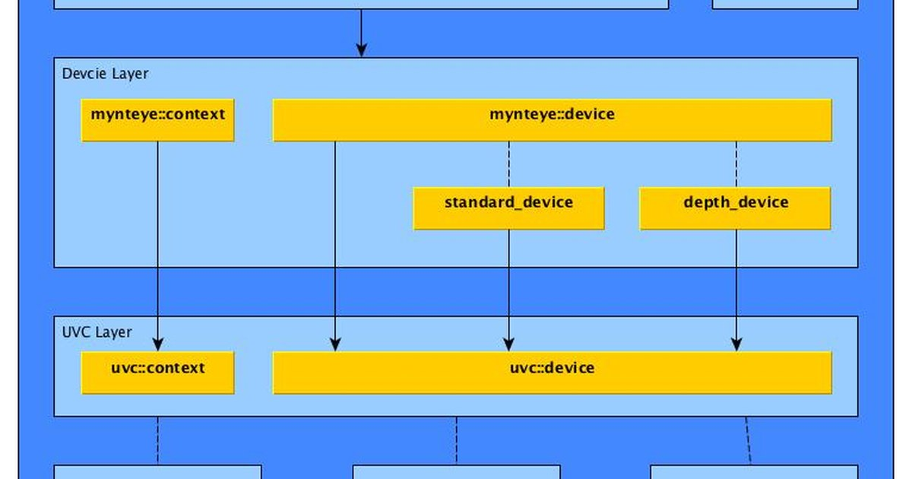

<h3 align="center"><strong>02. 小觅双目相机系列</strong></h3>

<table width="100%">
  <tbody>
    <tr>
      <td><strong>摘要</strong></td>
      <td>小觅智能（MYNT EYE）标准版双目相机的跨平台 SDK，提供图像采集、双目同步、深度计算与标定参数的统一接口。</td>
    </tr>
    <tr>
      <td><strong>特点</strong></td>
      <td>跨平台支持做得比较完整，Windows 10、Ubuntu 16.04 / 14.04、Jetson TX2 都有测试过的版本；SDK 封装了双目同步采集与深度图计算，不用自己处理左右目时间戳对齐；相机出厂带标定参数，SDK 直接读取，省去标定环节；双目方案在室内近距离场景下比结构光更稳，适合做视觉 SLAM 与抓取的前端感知；是国产双目相机里资料相对齐全的一款。</td>
    </tr>
    <tr>
      <td><strong>硬件 方案</strong></td>
      <td>MYNT EYE 标准版双目相机；支持 Windows / Ubuntu / Jetson 平台。</td>
    </tr>
    <tr>
      <td><strong>GitHub 链接</strong></td>
      <td><a href="https://github.com/slightech/MYNT-EYE-S-SDK">MYNT-EYE-S-SDK</a></td>
    </tr>
  </tbody>
</table>

---

### 🧠 3. 具身模型与平台工具链

涵盖 VLA 操作模型、对话智能体、具身智能平台与零代码创作工具。

#### 具身模型

  

<h3 align="center"><strong>01. GR-1（ByteDance Model）</strong></h3>

<table width="100%">
  <tbody>
    <tr>
      <td><strong>摘要</strong></td>
      <td>字节跳动开源的多模态视频预训练机器人操作模型，先在大规模视频数据上学习世界动态，再迁移到机器人操作任务上，论文被 ICLR 2024 接收。</td>
    </tr>
    <tr>
      <td><strong>特点</strong></td>
      <td>核心思路是把视频生成式预训练用到机器人操作上——视频里天然包含物体怎么动、手怎么伸这些物理常识，比纯文本预训练更贴近操作任务；采用 GPT 风格的统一架构同时处理视觉与动作，预测未来帧的同时输出动作序列；在 CALVIN 等长程操作基准上表现优于同期方法；代码与论文齐全，适合作为视频预训练路线的参考实现。</td>
    </tr>
    <tr>
      <td><strong>硬件 方案</strong></td>
      <td>需要机器人操作数据集做微调；模型推理需要 GPU，代码基于 PyTorch。</td>
    </tr>
    <tr>
      <td><strong>GitHub 链接</strong></td>
      <td><a href="https://github.com/bytedance/GR-1">GR-1</a></td>
    </tr>
  </tbody>
</table>

配套资料：<a href="https://gr1-manipulation.github.io/">项目主页</a> · <a href="https://arxiv.org/abs/2312.13139">arXiv 论文</a>

#### 平台与工具链

  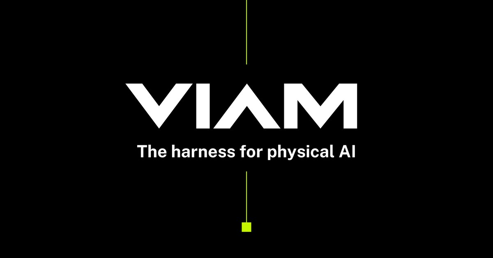

<h3 align="center"><strong>01. Viam</strong></h3>

<table width="100%">
  <tbody>
    <tr>
      <td><strong>摘要</strong></td>
      <td>开源的机器人软件平台，把硬件驱动、云端管理、数据采集与机器学习部署整合成一套工具链，支持在浏览器里配置机器人并远程下发指令。</td>
    </tr>
    <tr>
      <td><strong>特点</strong></td>
      <td>定位是机器人的「操作系统层」，硬件驱动、配置、数据、模型都在同一个平台里管理，不用自己拼一堆零散工具；提供云端界面，可以在浏览器里直接配置机器人、看传感器数据、发控制指令；支持多种主流硬件，接入新硬件只需按规范写驱动模块；开源且可自托管，不强制绑定厂商云服务；适合需要快速搭起机器人软件栈、又不想从零造轮子的团队。</td>
    </tr>
    <tr>
      <td><strong>硬件 方案</strong></td>
      <td>硬件无关，支持树莓派、Jetson、x86 等常见计算平台，可接入多种传感器与执行器。</td>
    </tr>
    <tr>
      <td><strong>GitHub 链接</strong></td>
      <td><a href="https://github.com/viamrobotics">Viam Robotics</a></td>
    </tr>
  </tbody>
</table>

配套资料：<a href="https://www.viam.com/">官网</a>

  

<h3 align="center"><strong>02. 京东 JoyInside</strong></h3>

<table width="100%">
  <tbody>
    <tr>
      <td><strong>摘要</strong></td>
      <td>京东推出的具身智能开放平台，把京东在对话交互与内容生态上的能力开放给机器人厂商，让硬件具备自然语言对话与智能体能力。</td>
    </tr>
    <tr>
      <td><strong>特点</strong></td>
      <td>依托京东的对话模型与语音能力，接入后机器人可以直接具备多轮对话与意图理解；面向硬件厂商，提供 SDK 与接入流程，不需要自己训练对话模型；背靠京东的内容与服务生态，可以打通商品、服务等场景；属于平台服务型项目，公开资料以官方站点与接入文档为主，开源代码有限。</td>
    </tr>
    <tr>
      <td><strong>硬件 方案</strong></td>
      <td>需要联网，硬件侧通过官方 SDK 接入；对主控平台无严格限制。</td>
    </tr>
    <tr>
      <td><strong>官方 链接</strong></td>
      <td><a href="https://joyinside.com/">JoyInside 官网</a></td>
    </tr>
  </tbody>
</table>

<h3 align="center"><strong>03. 北京人形机器人创新中心·慧思开物</strong></h3>

<table width="100%">
  <tbody>
    <tr>
      <td><strong>摘要</strong></td>
      <td>北京人形机器人创新中心推出的通用具身智能平台，包含具身大脑与具身小脑两部分，目标是做机器人本体的通用软件底座。</td>
    </tr>
    <tr>
      <td><strong>特点</strong></td>
      <td>把机器人的「思考」与「运动」拆成大脑和小脑两层，大脑负责任务理解与规划，小脑负责实时运动控制；由国家级创新中心主导，背后有天工等实体机器人项目做验证；平台面向多种机器人本体，不是绑定单一机型；目前以平台官网与开放能力介绍为主，开放程度按官方公布的节奏推进。</td>
    </tr>
    <tr>
      <td><strong>硬件 方案</strong></td>
      <td>面向多形态机器人本体，具体适配清单以官方公布为准。</td>
    </tr>
    <tr>
      <td><strong>官方 链接</strong></td>
      <td><a href="https://open.x-humanoid-cloud.com/">慧思开物平台</a></td>
    </tr>
  </tbody>
</table>

  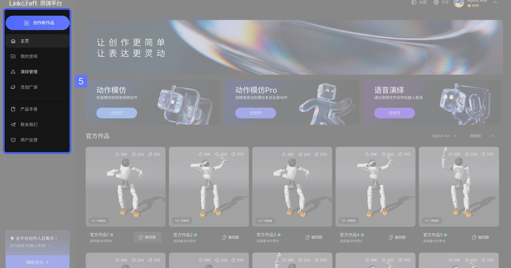

<h3 align="center"><strong>04. 智元灵创平台 LinkCraft</strong></h3>

<table width="100%">
  <tbody>
    <tr>
      <td><strong>摘要</strong></td>
      <td>智元机器人推出的内容创作与动作编排平台，面向智元自家机器人提供动作生成、编排与下发能力，降低机器人表演与交互内容的制作门槛。</td>
    </tr>
    <tr>
      <td><strong>特点</strong></td>
      <td>把机器人动作拆成可编排的片段，用图形化方式拼接，不需要写代码就能做出完整表演；面向内容创作场景，适合展览、活动、科普等需要快速产出机器人动作的场合；与智元的硬件本体绑定，做出来的内容可以直接下发到实机；属于平台服务型项目，公开资料以官方介绍页为主。</td>
    </tr>
    <tr>
      <td><strong>硬件 方案</strong></td>
      <td>运行于智元机器人本体，具体机型支持以官方公布为准。</td>
    </tr>
    <tr>
      <td><strong>官方 链接</strong></td>
      <td><a href="https://www.agibot.com.cn/filepage/295.html">LinkCraft 介绍</a></td>
    </tr>
  </tbody>
</table>

  

<h3 align="center"><strong>05. 网易灵动·灵掘</strong></h3>

<table width="100%">
  <tbody>
    <tr>
      <td><strong>摘要</strong></td>
      <td>网易伏羲旗下机器人品牌的挖掘机器人产品，把具身智能能力用在工程机械上，实现挖掘作业的远程操控与自动化。</td>
    </tr>
    <tr>
      <td><strong>特点</strong></td>
      <td>面向的是工程机械这个相对少见的场景，不是通用的桌面或人形机器人；依托网易伏羲在游戏 AI 与强化学习上的积累，把智能决策用到挖掘作业里；提供远程操控与作业管理能力，属于产品化程度较高的具身智能落地案例；公开资料以产品介绍为主，底层算法与代码未完全开放。</td>
    </tr>
    <tr>
      <td><strong>硬件 方案</strong></td>
      <td>挖掘机器人整机（工程机械底盘 + 传感器 + 计算单元），具体型号以官方公布为准。</td>
    </tr>
    <tr>
      <td><strong>官方 链接</strong></td>
      <td><a href="https://lingdong.fuxi.163.com/productSummary/wj">灵掘产品页</a></td>
    </tr>
  </tbody>
</table>

  

<h3 align="center"><strong>06. 腾讯 Tairos（钛螺丝）</strong></h3>

<table width="100%">
  <tbody>
    <tr>
      <td><strong>摘要</strong></td>
      <td>腾讯推出的具身智能开放平台，为机器人厂商提供感知、规划、控制等基础能力，让硬件团队不必自己从零搭建 AI 能力栈。</td>
    </tr>
    <tr>
      <td><strong>特点</strong></td>
      <td>由腾讯云主导，把大模型、视觉、语音等能力打包成机器人可用的服务；面向机器人厂商提供接入方案，合作机型覆盖多种形态；强调「开箱可用」，厂商接入后可以快速具备智能交互与任务执行能力；属于平台服务型项目，代码未开源，接入方式以官方文档为准。</td>
    </tr>
    <tr>
      <td><strong>硬件 方案</strong></td>
      <td>需要联网，硬件侧按官方接入方案改造；对主控平台无严格限制。</td>
    </tr>
    <tr>
      <td><strong>官方 链接</strong></td>
      <td><a href="https://tairos.tencent.com/">Tairos 官网</a></td>
    </tr>
  </tbody>
</table>

---

### 🛠️ 4. 数据、训练与遥操作

涵盖强化学习、模仿学习、数据采集、遥操作系统与机器人开发教程。

#### 学习与训练框架

  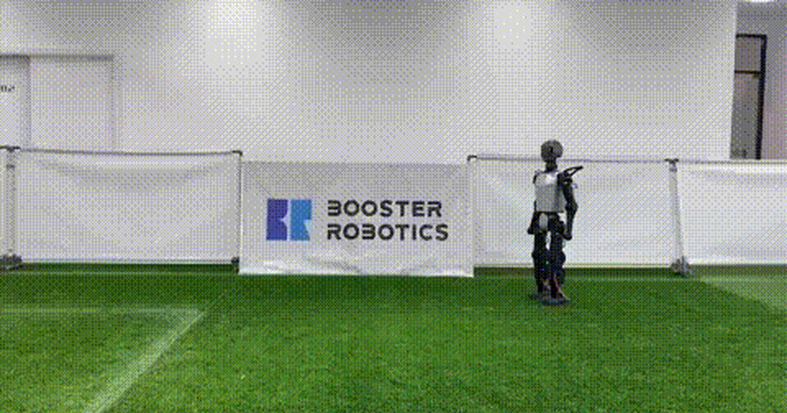

<h3 align="center"><strong>01. Booster Gym</strong></h3>

<table width="100%">
  <tbody>
    <tr>
      <td><strong>摘要</strong></td>
      <td>Booster Robotics 面向人形机器人运动控制的强化学习框架，把训练、部署、资产三个环节拆成独立仓库，形成从仿真到实机的完整流水线。</td>
    </tr>
    <tr>
      <td><strong>特点</strong></td>
      <td>拆分成 Booster Train（训练）、Booster Deploy（部署）、Booster Assets（模型与动作数据）三个仓库，可以按需取用；训练侧基于 Isaac Lab，支持 K1 等机型的多类强化学习任务；部署侧提供了易用的框架，训练出的策略可以无缝跑到实机；官方有实机部署演示视频，说明整条链路是跑通过的；适合需要快速验证人形运动控制策略的团队。</td>
    </tr>
    <tr>
      <td><strong>硬件 方案</strong></td>
      <td>面向 Booster 人形机器人（如 K1）；训练侧需要 NVIDIA GPU，基于 Isaac Lab 仿真环境。</td>
    </tr>
    <tr>
      <td><strong>GitHub 链接</strong></td>
      <td><a href="https://github.com/BoosterRobotics/booster_gym">Booster Gym</a> · <a href="https://github.com/BoosterRobotics/booster_train">Booster Train</a> · <a href="https://github.com/BoosterRobotics/booster_deploy">Booster Deploy</a></td>
    </tr>
  </tbody>
</table>

配套资料：<a href="https://github.com/BoosterRobotics/booster_assets">Booster Assets</a>

  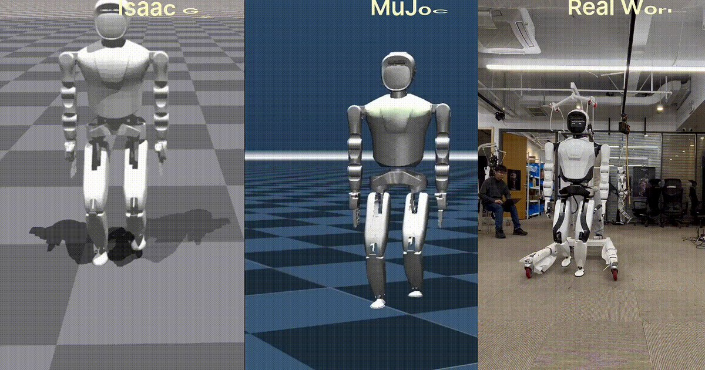

<h3 align="center"><strong>02. Humanoid-Gym</strong></h3>

<table width="100%">
  <tbody>
    <tr>
      <td><strong>摘要</strong></td>
      <td>面向人形机器人的强化学习训练框架，主打零样本仿真到现实（Zero-Shot Sim2Real）迁移，在仿真里训练好的策略可以直接部署到实机。</td>
    </tr>
    <tr>
      <td><strong>特点</strong></td>
      <td>核心卖点是免调参的 Sim2Real——通过域随机化与对称性奖励等设计，训练出的策略不需要在实机上微调就能用；框架基于 Isaac Gym，训练速度快，单卡就能在几小时内训出一个可行走的策略；提供完整的训练、播放、导出流程，以及配套的评估脚本；论文有明确的实验对比，在多个地形上的迁移效果都有展示；是研究人形机器人运动控制时的重要基线。</td>
    </tr>
    <tr>
      <td><strong>硬件 方案</strong></td>
      <td>训练需要 NVIDIA GPU，基于 Isaac Gym；部署目标为人形机器人本体，官方以 XBot 系列验证。</td>
    </tr>
    <tr>
      <td><strong>GitHub 链接</strong></td>
      <td><a href="https://github.com/roboterax/humanoid-gym">Humanoid-Gym</a></td>
    </tr>
  </tbody>
</table>

配套资料：<a href="https://sites.google.com/view/humanoid-gym/">项目主页</a> · <a href="https://arxiv.org/abs/2404.05695">arXiv 论文</a>

  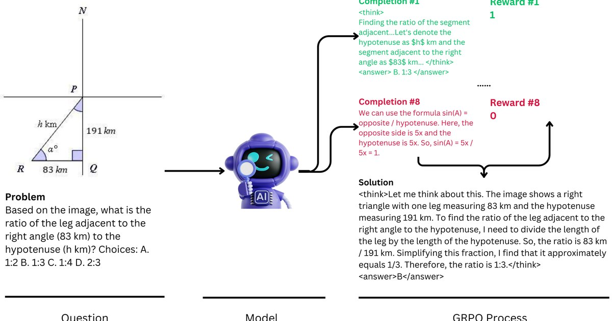

<h3 align="center"><strong>03. OpenR1-Multimodal</strong></h3>

<table width="100%">
  <tbody>
    <tr>
      <td><strong>摘要</strong></td>
      <td>在 Qwen2-VL 基础上复现 DeepSeek-R1 强化学习范式的多模态项目，用 GRPO 让视觉语言模型学会先推理再回答。</td>
    </tr>
    <tr>
      <td><strong>特点</strong></td>
      <td>把 R1 的强化学习思路从纯文本扩展到多模态，说明这套范式在视觉任务上一样成立；完整复现了训练流程，模型、数据集、代码都在 HuggingFace 与 GitHub 上公开；训练数据规模不大（8k 级别）但效果明显，说明 GRPO 的数据效率较高；官方对实验结论保持克制，明确表示「见解不一定正确，但会诚实分享」；适合作为理解强化学习如何作用于多模态模型的实践材料。</td>
    </tr>
    <tr>
      <td><strong>硬件 方案</strong></td>
      <td>训练需要多卡 GPU；模型基于 Qwen2-VL-2B，推理可在消费级显卡上运行。</td>
    </tr>
    <tr>
      <td><strong>GitHub 链接</strong></td>
      <td><a href="https://github.com/EvolvingLMMs-Lab/open-r1-multimodal">open-r1-multimodal</a></td>
    </tr>
  </tbody>
</table>

配套资料：<a href="https://huggingface.co/lmms-lab/Qwen2-VL-2B-GRPO-8k">HuggingFace 模型</a>

  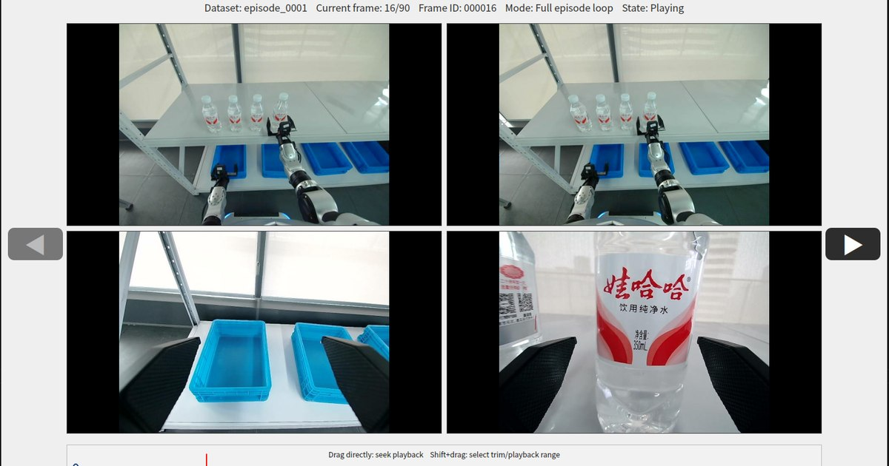

<h3 align="center"><strong>04. unitree_IL_lerobot</strong></h3>

<table width="100%">
  <tbody>
    <tr>
      <td><strong>摘要</strong></td>
      <td>宇树基于 LeRobot 生态构建的模仿学习工具链，把宇树机器人的数据采集、数据集转换、策略训练与部署串成一条流水线。</td>
    </tr>
    <tr>
      <td><strong>特点</strong></td>
      <td>跟上 LeRobot 的版本节奏，已支持 lerobot dataset v3.0 格式；策略侧支持 pi0、pi05、GR00T 等多个主流 VLA 模型，不必自己实现；配套 any4lerobot 工具可以做不同版本数据集之间的格式转换；与宇树的 AVP 遥操作、Isaac Lab 仿真等仓库打通，形成采数据—训练—部署的闭环；数据集托管在 HuggingFace，可以直接下载复现。</td>
    </tr>
    <tr>
      <td><strong>硬件 方案</strong></td>
      <td>面向宇树机器人本体；训练需要 GPU，数据采集需配合 AVP 遥操作或 XR 遥操作设备。</td>
    </tr>
    <tr>
      <td><strong>GitHub 链接</strong></td>
      <td><a href="https://github.com/unitreerobotics/unitree_IL_lerobot">unitree_IL_lerobot</a> · <a href="https://github.com/unitreerobotics/avp_teleoperate">AVP 遥操作</a> · <a href="https://github.com/unitreerobotics/unitree_sim_isaaclab">仿真环境</a></td>
    </tr>
  </tbody>
</table>

配套资料：<a href="https://huggingface.co/unitreerobotics">宇树数据集（HuggingFace）</a>

  

<h3 align="center"><strong>05. unitree_rl_gym</strong></h3>

<table width="100%">
  <tbody>
    <tr>
      <td><strong>摘要</strong></td>
      <td>宇树的强化学习运动控制框架，基于 Isaac Gym 提供多机型并行训练环境，配合 MuJoCo 做仿真到仿真的验证，最终部署到实机。</td>
    </tr>
    <tr>
      <td><strong>特点</strong></td>
      <td>把强化学习控制流程拆成 Train → Play → Sim2Sim → Sim2Real 四步，每一步都有对应命令，路径清晰；基于 Isaac Gym，支持大规模并行环境，训练效率高；提供 MuJoCo 的 Sim2Sim 环节，在部署实机前多一层验证，减少炸机风险；支持宇树多款机型（四足与人形），一套流程可以复用；是入门宇树强化学习控制最直接的起点。</td>
    </tr>
    <tr>
      <td><strong>硬件 方案</strong></td>
      <td>训练需要 NVIDIA GPU，基于 Isaac Gym；Sim2Sim 依赖 MuJoCo；部署目标为宇树机器人本体。</td>
    </tr>
    <tr>
      <td><strong>GitHub 链接</strong></td>
      <td><a href="https://github.com/unitreerobotics/unitree_rl_gym">unitree_rl_gym</a></td>
    </tr>
  </tbody>
</table>

<h3 align="center"><strong>06. unitree_rl_lab</strong></h3>

<table width="100%">
  <tbody>
    <tr>
      <td><strong>摘要</strong></td>
      <td>宇树基于 NVIDIA Isaac Lab 构建的新一代强化学习环境集合，为宇树机器人提供标准化的训练任务与并行环境。</td>
    </tr>
    <tr>
      <td><strong>特点</strong></td>
      <td>从 Isaac Gym 迁移到 Isaac Lab，跟进 NVIDIA 官方推荐的技术路线；Isaac Lab 本身在资产管理、传感器仿真、域随机化方面的抽象更完善，写新任务比 Isaac Gym 时代省事；提供一组开箱可用的宇树机器人任务，可直接训练也可在此基础上改；采用 Apache 2.0 许可，商用友好；适合已经跟上 Isaac Lab 生态、需要宇树机型资产与任务的用户。</td>
    </tr>
    <tr>
      <td><strong>硬件 方案</strong></td>
      <td>Isaac Sim 5.1 + Isaac Lab 2.3；训练需要 NVIDIA RTX 系列 GPU。</td>
    </tr>
    <tr>
      <td><strong>GitHub 链接</strong></td>
      <td><a href="https://github.com/unitreerobotics/unitree_rl_lab">unitree_rl_lab</a></td>
    </tr>
  </tbody>
</table>

#### 数据采集与遥操作

  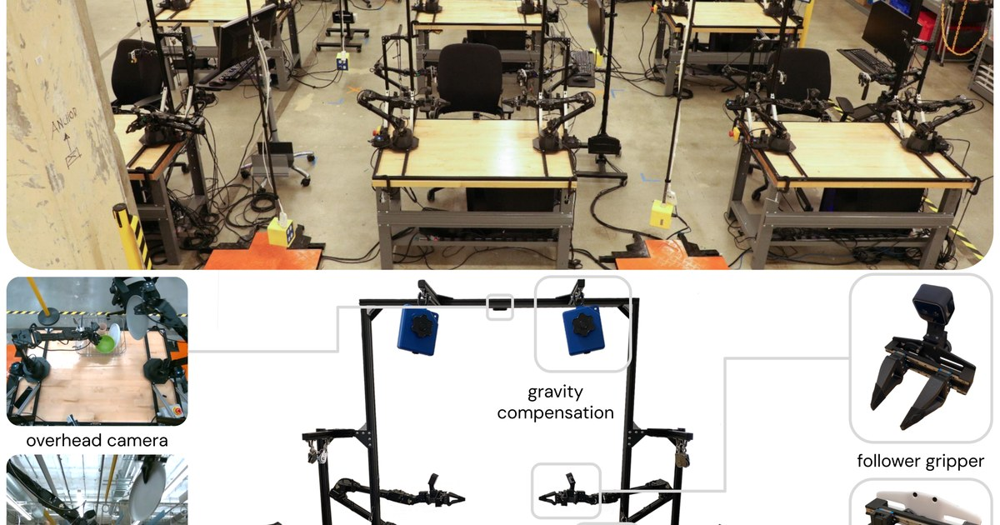

<h3 align="center"><strong>01. ALOHA 2</strong></h3>

<table width="100%">
  <tbody>
    <tr>
      <td><strong>摘要</strong></td>
      <td>斯坦福与 Google DeepMind 联合推出的低成本双臂遥操作与示教平台，用主从臂结构让操作者可以直接「带着」机器人做动作，采集高质量示教数据。</td>
    </tr>
    <tr>
      <td><strong>特点</strong></td>
      <td>主从臂设计让操作者的动作直接映射到从臂，采集的数据天然带着人类的操作技巧，比遥控手柄自然得多；整机成本控制在两万美元级别，是同类双臂平台里最便宜的之一；ALOHA 2 在 1.0 基础上改进了重力补偿、夹爪与线束，耐用性提升明显；配套 ACT 等模仿学习算法，从示教到策略的链路完整；被学术界广泛采用，是双臂操作研究的事实标准平台之一。</td>
    </tr>
    <tr>
      <td><strong>硬件 方案</strong></td>
      <td>主臂 + 从臂的双臂结构，共 14 个自由度左右；采用 Dynamixel 舵机；整机成本约两万美元级别。</td>
    </tr>
    <tr>
      <td><strong>官方 链接</strong></td>
      <td><a href="https://aloha-2.github.io/">ALOHA 2 项目页</a></td>
    </tr>
  </tbody>
</table>

配套资料：<a href="https://arxiv.org/abs/2406.09246">论文（arXiv）</a>

  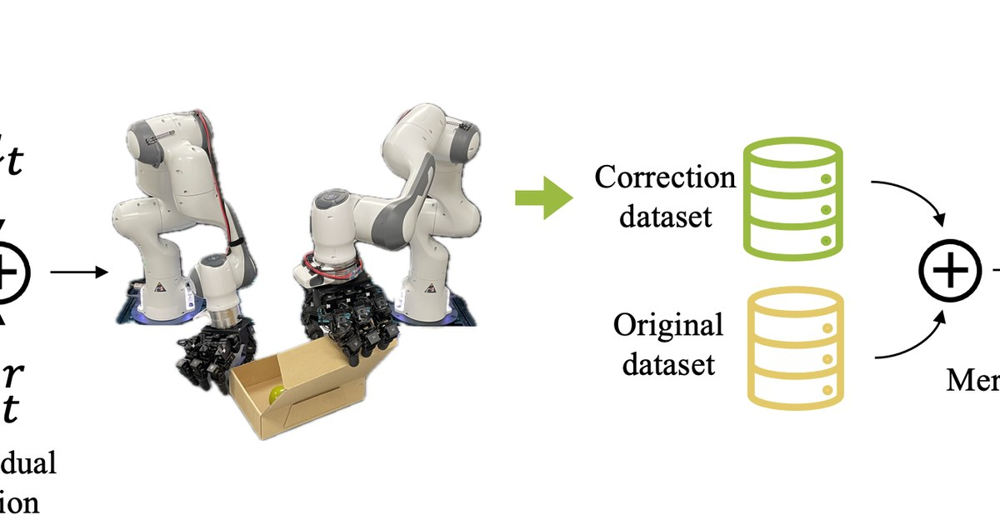

<h3 align="center"><strong>02. DexCap</strong></h3>

<table width="100%">
  <tbody>
    <tr>
      <td><strong>摘要</strong></td>
      <td>斯坦福开源的便携式手部动作捕捉与灵巧操作数据采集系统，用穿戴式设备捕捉手指动作，把人类手的精细操作直接映射到灵巧手上。</td>
    </tr>
    <tr>
      <td><strong>特点</strong></td>
      <td>穿戴式方案解放了操作者的活动范围，不像固定台架只能在特定区域采数据；重点捕捉的是手指的精细动作，这是灵巧操作数据里最难获取的部分；采集的数据可以直接用于训练灵巧手策略，省去从视频反推手部姿态的步骤；硬件成本比专业动捕设备低得多，适合实验室自建；是灵巧操作数据采集方向上比较有代表性的方案。</td>
    </tr>
    <tr>
      <td><strong>硬件 方案</strong></td>
      <td>穿戴式手部动捕设备 + 灵巧手执行端；采集与训练需配套计算单元。</td>
    </tr>
    <tr>
      <td><strong>官方 链接</strong></td>
      <td><a href="https://dex-cap.github.io/">DexCap 项目页</a></td>
    </tr>
  </tbody>
</table>

  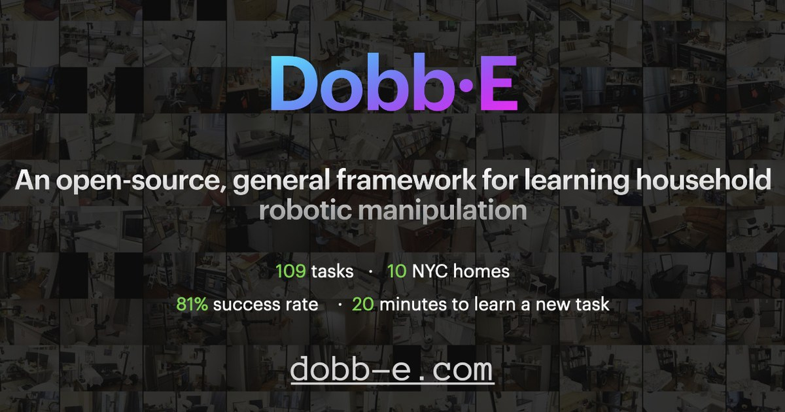

<h3 align="center"><strong>03. Dobb-E</strong></h3>

<table width="100%">
  <tbody>
    <tr>
      <td><strong>摘要</strong></td>
      <td>用 iPhone 做遥操作与数据采集的机器人学习系统，靠一个简单的「Reacher」夹爪工具把手机夹在机械臂末端，就能采集操作数据并训练策略。</td>
    </tr>
    <tr>
      <td><strong>特点</strong></td>
      <td>采集设备就是一台 iPhone，把成本压到了极低，任何有机械臂的实验室都能复制；配套的 Reacher 夹爪工具结构简单，可以 3D 打印；演示了从零开始在一个家庭环境里采集数据、训练、部署的全流程；强调在非实验室的真实场景里工作，泛化能力是核心关注点；是「低成本采集 + 快速部署」这类工作的典型代表。</td>
    </tr>
    <tr>
      <td><strong>硬件 方案</strong></td>
      <td>机械臂 + iPhone（做位姿与视觉采集）+ 3D 打印 Reacher 夹爪。</td>
    </tr>
    <tr>
      <td><strong>官方 链接</strong></td>
      <td><a href="https://dobb-e.com/">Dobb-E 项目页</a></td>
    </tr>
  </tbody>
</table>

  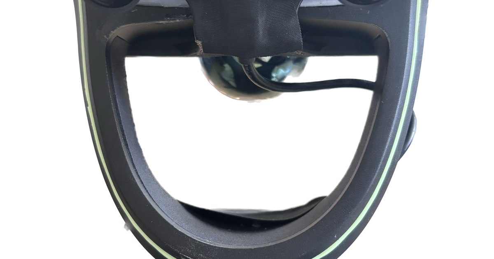

<h3 align="center"><strong>04. 宇树科技 XR 遥操作</strong></h3>

<table width="100%">
  <tbody>
    <tr>
      <td><strong>摘要</strong></td>
      <td>宇树开源的 XR 遥操作系统，用 Apple Vision Pro 等扩展现实设备操控宇树人形机器人，操作者的头与手动作实时映射到机器人上。</td>
    </tr>
    <tr>
      <td><strong>特点</strong></td>
      <td>用 XR 头显做遥操作，操作者能看到机器人视角的画面，同时用手势直接控制手臂与夹爪，沉浸感和直觉性都比手柄强；持续更新，已支持 H2、R1（A5/A7）等新机型，以及 BrainCo 手部控制器的输入；默认采用相对头偏航的手臂参考坐标系，长时间操作不容易疲劳；与 unitree_IL_lerobot 打通，采集的数据可以直接进训练流程；是当前人形机器人遥操作里比较好用的开源方案。</td>
    </tr>
    <tr>
      <td><strong>硬件 方案</strong></td>
      <td>Apple Vision Pro 或其他 XR 设备 + 宇树人形机器人（H2、R1 等）；可选 BrainCo 手部控制器。</td>
    </tr>
    <tr>
      <td><strong>GitHub 链接</strong></td>
      <td><a href="https://github.com/unitreerobotics/xr_teleoperate">xr_teleoperate</a></td>
    </tr>
  </tbody>
</table>

#### 教程与知识库

  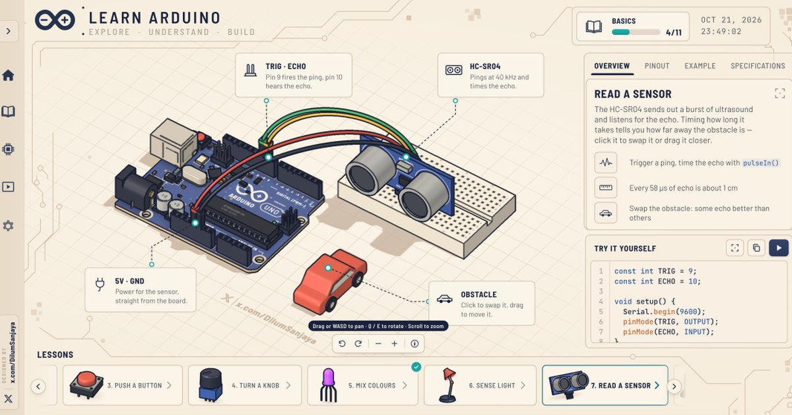

<h3 align="center"><strong>01. Learn Arduino</strong></h3>

<table width="100%">
  <tbody>
    <tr>
      <td><strong>摘要</strong></td>
      <td>浏览器里的 Arduino 三维互动课程，在虚拟开发板上拖线、接元件、改代码，观察 LED、舵机与传感器的模拟反馈，适合动手买板之前先建立硬件直觉。</td>
    </tr>
    <tr>
      <td><strong>特点</strong></td>
      <td>三维板级视图，可旋转缩放开发板，引脚与导线按电路连接摆放，接错线当场可见；课程内可直接改代码运行，并带串口监视器；16 节递进课程，从点亮 LED、按钮、电位器到超声波、舵机与步进电机，最后做成避障红绿灯项目；零硬件门槛，但不呈现接触不良、供电不足等真实问题。</td>
    </tr>
    <tr>
      <td><strong>硬件   方案</strong></td>
      <td>无硬件依赖，纯浏览器内运行的三维电路仿真与课程，无需下载安装。</td>
    </tr>
    <tr>
      <td><strong>GitHub   链接</strong></td>
      <td>暂未核实到官方 GitHub 源码仓库，在线使用：<a href="https://learn-arduino-red.vercel.app/">learn-arduino-red.vercel.app</a></td>
    </tr>
  </tbody>
</table>

配套资料：站点由 <a href="https://x.com/DilumSanjaya">Dilum Sanjaya</a> 设计（独立开发者作品，非 Arduino 官方产品）

  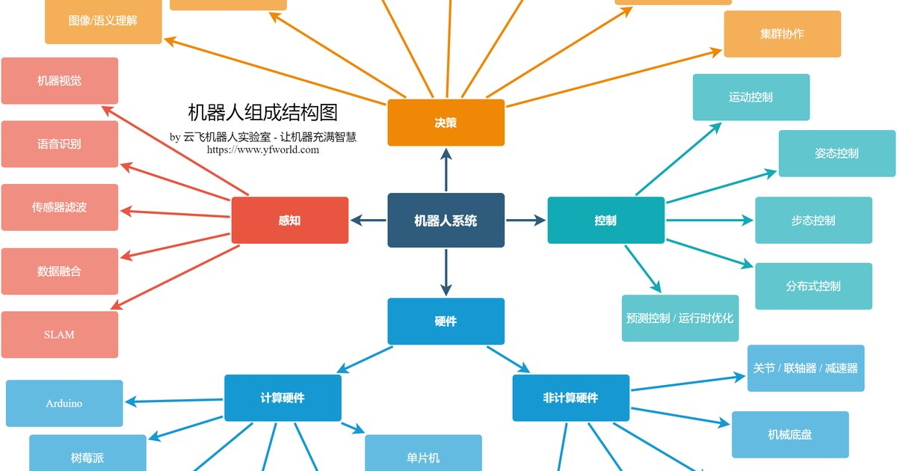

<h3 align="center"><strong>02. RoboWiki</strong></h3>

<table width="100%">
  <tbody>
    <tr>
      <td><strong>摘要</strong></td>
      <td>云飞机器人实验室发起的中文机器人维基，采用公共知识编辑的方式，覆盖机器人设计、建模、仿真、编程、视觉、算法与行业应用。</td>
    </tr>
    <tr>
      <td><strong>特点</strong></td>
      <td>走的是维基百科式的众包路线，提倡「知识自由」，任何人都可以参与编辑；内容按机器人研发的完整链条组织，从设计建模到算法应用都有覆盖；由 B 站机器人科普 UP 主云飞机器人实验室发起，内容风格偏工程实践；适合作为查找中文机器人资料的入口，遇到陌生概念先来这里扫一遍。</td>
    </tr>
    <tr>
      <td><strong>硬件 方案</strong></td>
      <td>无硬件要求，纯知识库项目。</td>
    </tr>
    <tr>
      <td><strong>GitHub 链接</strong></td>
      <td><a href="https://github.com/yfrobotics/robowiki">RoboWiki</a></td>
    </tr>
  </tbody>
</table>

配套资料：<a href="https://space.bilibili.com/493264461">发起方 B 站主页</a>

<h3 align="center"><strong>03. 宇树科技机器人控制教程</strong></h3>

<table width="100%">
  <tbody>
    <tr>
      <td><strong>摘要</strong></td>
      <td>宇树开源的机器人控制教学项目，配套《四足机器人控制算法》一书，从 Gazebo 仿真入手讲清楚四足机器人的建模、状态估计与运动控制。</td>
    </tr>
    <tr>
      <td><strong>特点</strong></td>
      <td>是少数以「教学」为主目标的官方开源项目，代码跟着书里的章节走，不是零散示例的堆砌；从 Gazebo 仿真环境快速起步，不需要先有实机；覆盖四足机器人控制的核心环节：腿部运动学、机身状态估计、步态生成与平衡控制；宇树开发者站点上还有更详细的文档补充；推荐在 Ubuntu 18.04 + ROS Melodic 环境运行；适合系统学习四足控制而不是只想跑个 demo 的人。</td>
    </tr>
    <tr>
      <td><strong>硬件 方案</strong></td>
      <td>无实机也可学习，基于 Gazebo 仿真；推荐 Ubuntu 18.04 + ROS Melodic；有宇树四足实机可直接部署。</td>
    </tr>
    <tr>
      <td><strong>GitHub 链接</strong></td>
      <td><a href="https://github.com/unitreerobotics/unitree_guide">unitree_guide</a></td>
    </tr>
  </tbody>
</table>

配套资料：<a href="https://support.unitree.com/home/zh/Algorithm_Practice">宇树开发者文档</a>

