# Robot Systems & Open-Source Hardware

A curated collection of open-source robotics and hardware projects. Each
entry highlights the robot’s capabilities, hardware requirements,
official code, and reproduction resources to help developers find
projects suited to their needs.

## Contents

- [🆕 Latest Highlights](#new-projects)
  - [01. Xiaochujun Dexterous Hand](#project-xiaochujun-dexterous-hand)
  - [02. XGO-Duck](#project-xgoduck)
  - [03. RIG-Arm](#project-rig-arm)
  - [04. RIG-Puppy](#project-rig-puppy)
  - [05. PhoneBot](#project-phonebot)
  - [06. Learn Arduino](#project-learn-arduino)
  - [07. Dummy-Robot](#project-dummy-robot)
  - [08. RIG-Hover](#project-rig-hover)
  - [09. OpenCat / Bittle X](#project-opencat)
  - [10. Open Duck Mini v2](#project-open-duck-mini)
  - [11. ToddlerBot 2.0](#project-toddlerbot)
  - [12. Berkeley Humanoid Lite V1](#project-berkeley-humanoid-lite)
- [🤖 More Robot Projects](#open-source-projects)
  - [🦾 1. Robot Systems & Open-Source Hardware](#hardware)
    - [Humanoid Robots](#hardware-humanoid)
    - [Quadruped Robots](#hardware-quadruped)
    - [Robotic Arms & Desktop Robots](#hardware-arms)
    - [Mobile Robots](#hardware-mobile)
  - [👁️ 2. Perception & Manipulation Algorithms](#perception)
    - [SLAM & Perception](#algo-slam)
    - [Grasping & Manipulation](#algo-grasping)
  - [🧠 3. Embodied Models & Platform Toolchains](#models)
    - [Embodied Models](#model-vla)
    - [Platforms & Toolchains](#model-platform)
  - [🛠️ 4. Data, Training & Teleoperation](#data)
    - [Learning & Training Frameworks](#data-rl)
    - [Data Collection & Teleoperation](#data-teleop)
    - [Tutorials & Knowledge Bases](#data-tutorial)

## 🆕 Latest Highlights

  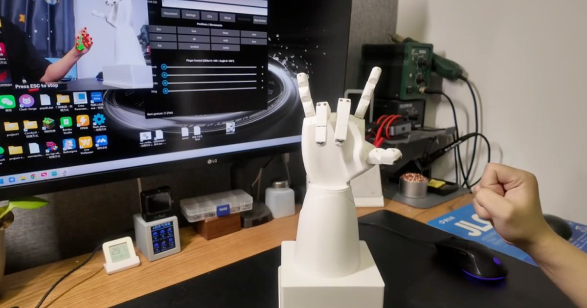

<h3 align="center"><strong>01. Xiaochujun Dexterous Hand</strong></h3>

<table width="100%">
  <tbody>
    <tr>
      <td><strong>Summary</strong></td>
      <td>A 3D-printed hand driven by hobby servos and cable tendons that pull the fingers closed, performing open, fist and grasp motions, with a companion phone app.</td>
    </tr>
    <tr>
      <td><strong>Features</strong></td>
      <td>Commodity servos supply the force while tensioned cables bend 3D-printed fingers, so not every joint needs its own motor. A hands-on example of underactuation in which one servo drives several joints through a tendon. The author publishes video tutorials as 「小楚君CC」 and distributes the files and app through cloud-drive links.</td>
    </tr>
    <tr>
      <td><strong>Hardware   plan</strong></td>
      <td>3D-printed palm and finger parts, drive servos, tendons with tubing, a controller board, battery and switch, fasteners and bearings. No complete bill of materials has been published; counts and models follow the author's materials.</td>
    </tr>
    <tr>
      <td><strong>GitHub   link</strong></td>
      <td>No official GitHub repository could be verified. Files are distributed by the author: <a href="https://pan.baidu.com/s/1QT5dh-R3a37De9sv_LerFw?pwd=xesd">Baidu Pan (xesd)</a> · <a href="https://pan.baidu.com/s/1nbod7cnuJ4-DOrkbAUGfgA?pwd=12as">App (12as)</a></td>
    </tr>
  </tbody>
</table>

Related resources: search 「小楚君CC」 on major video platforms.

  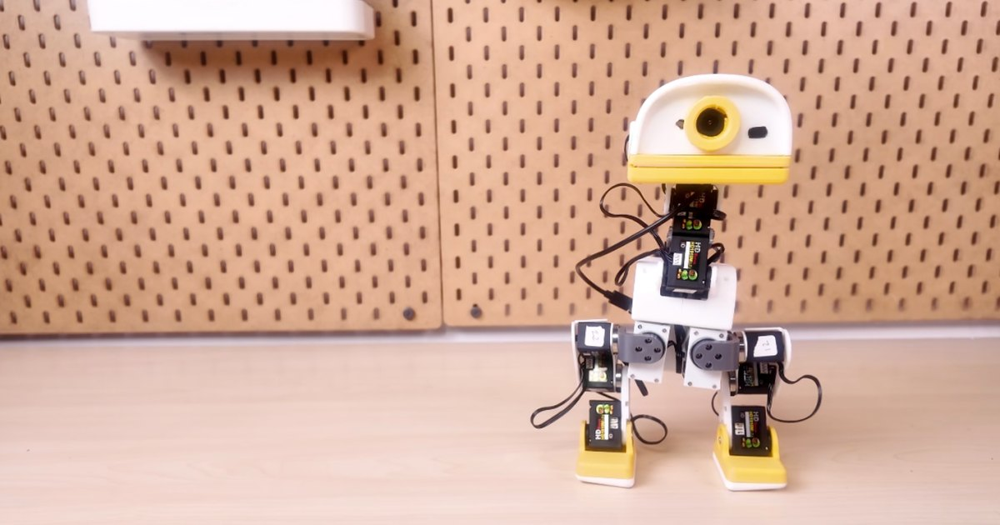

<h3 align="center"><strong>02. XGO-Duck</strong></h3>

<table width="100%">
  <tbody>
    <tr>
      <td><strong>Summary</strong></td>
      <td>A 3D-printable biped robot duck from Luwu Dynamics, adapted from Pollen Robotics' Microduck, built on an Arduino UNO Q and 15 serial servos with full structure files, expansion board, assembly guide and an RL training pipeline.</td>
    </tr>
    <tr>
      <td><strong>Features</strong></td>
      <td>Fifteen Feetech 1910 serial servos drive 10 leg joints, 4 neck/head joints and 1 mouth joint. The Arduino UNO Q splits the load: the Linux side runs ONNX policy inference and the web UI while the STM32 side handles 100 Hz servo and IMU loops. A custom expansion board integrates the IMU and servo bus, with PCBA, Gerber and BOM released. Policies are trained with reinforcement learning in simulation and deployed to the real robot.</td>
    </tr>
    <tr>
      <td><strong>Hardware   plan</strong></td>
      <td>Arduino UNO Q (2 GB or 4 GB), Luwu UNO Q expansion board (power distribution, servo interfaces, IMU), 15 × Feetech 1910 servos with AMP 3-pin cables, 8.4 V (2S 18650) battery pack with charger, bearings and fasteners, 3D-printed structure. Full BOM per the official repository.</td>
    </tr>
    <tr>
      <td><strong>GitHub   link</strong></td>
      <td><a href="https://github.com/LuwuDynamics/xgoduck_hardware">LuwuDynamics/xgoduck_hardware</a> · <a href="https://github.com/LuwuDynamics/xgoduck_runtime_arduino">runtime</a> · <a href="https://github.com/LuwuDynamics/xgoduck_rl">training</a></td>
    </tr>
  </tbody>
</table>

Related resources: <a href="https://www.arduino.cc/en/software/">Arduino IDE</a>

  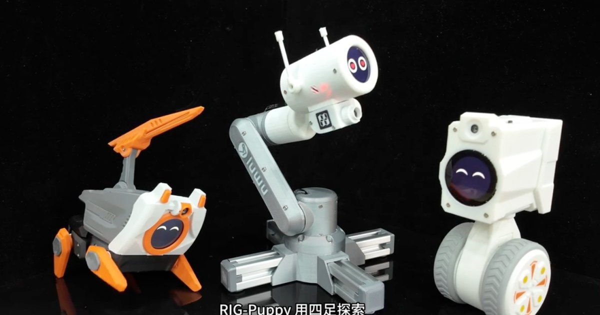

<h3 align="center"><strong>03. RIG-Arm</strong></h3>

<table width="100%">
  <tbody>
    <tr>
      <td><strong>Summary</strong></td>
      <td>The ARM board type of the open-source RIG-Omni ESP32-S3 firmware: a robotic-arm desktop robot combining arm motion, round-screen expressions, voice dialogue and gesture interaction in one body.</td>
    </tr>
    <tr>
      <td><strong>Features</strong></td>
      <td>One codebase covers the Puppy, Hover, ARM and TARS forms; boards share voice, networking and sensor drivers while implementing their own motion control. The ARM board provides arm calibration and a teach mode, callable by voice or remote. A round display plays expression animations and wake-word detection runs locally. BluFi provisioning, OTA updates and MCP tools are supported.</td>
    </tr>
    <tr>
      <td><strong>Hardware   plan</strong></td>
      <td>ESP32-S3, SCS009 serial bus servos, QMI8658C six-axis IMU, GC9A01 240×240 round LCD, I2S microphone plus amplifier and speaker, touch module and buttons, Li-ion battery and power management, 3D-printed structure. Exact configuration per the official BOM.</td>
    </tr>
    <tr>
      <td><strong>GitHub   link</strong></td>
      <td><a href="https://github.com/LuwuDynamics/rig_omni">LuwuDynamics/rig_omni</a></td>
    </tr>
  </tbody>
</table>

Related resources: [Official wiki](https://wiki.xgorobot.com/kb/pet-arm) · [MakerWorld models](https://makerworld.com.cn/zh/@LuwuDynamics)

  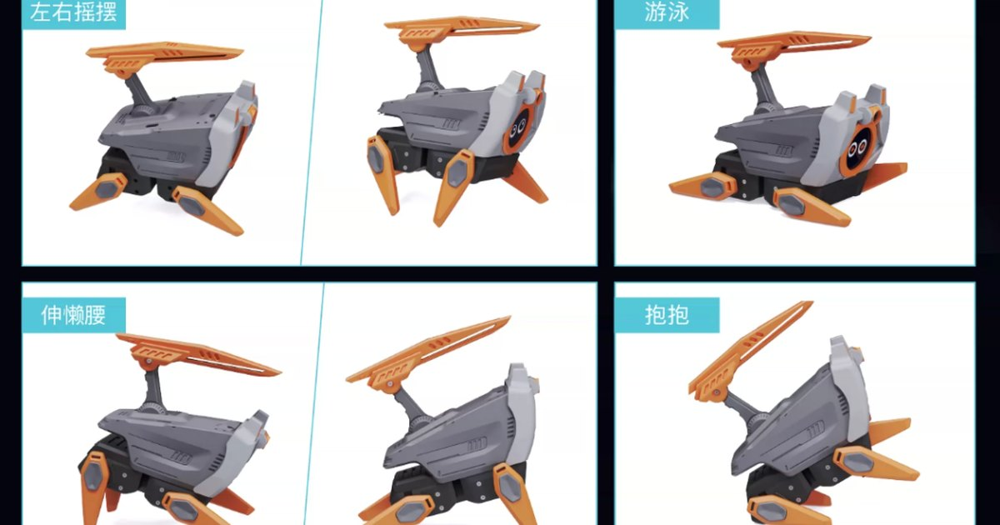

<h3 align="center"><strong>04. RIG-Puppy</strong></h3>

<table width="100%">
  <tbody>
    <tr>
      <td><strong>Summary</strong></td>
      <td>A puppy-shaped desktop robot from Luwu Dynamics driven by five bus servos, an ESP32-S3 and a round LCD, with voice dialogue backed by cloud LLM agents.</td>
    </tr>
    <tr>
      <td><strong>Features</strong></td>
      <td>Five-servo robot-dog form with preset sit, stand-up and tail-wag actions, plus head motion that follows device tilt via the IMU. The round LCD plays 20+ expression animations. Voice uses offline wake words with cloud ASR/TTS, wired into the Xiaozhi AI ecosystem with agent personality configuration. BluFi provisioning, OTA updates and MCP tools are supported, with an optional camera.</td>
    </tr>
    <tr>
      <td><strong>Hardware   plan</strong></td>
      <td>ESP32-S3 (N16R8), GC9A01 240×240 round LCD, five serial bus servos, QMI8658C six-axis IMU, I2S microphone plus amplifier and speaker, touch module, optional OV2640 camera, Li-ion battery and power management, 3D-printed shell and legs.</td>
    </tr>
    <tr>
      <td><strong>GitHub   link</strong></td>
      <td><a href="https://github.com/LuwuDynamics/rig_omni">LuwuDynamics/rig_omni</a></td>
    </tr>
  </tbody>
</table>

Related resources: [Official wiki](https://wiki.xgorobot.com/kb/pet-puppy)

  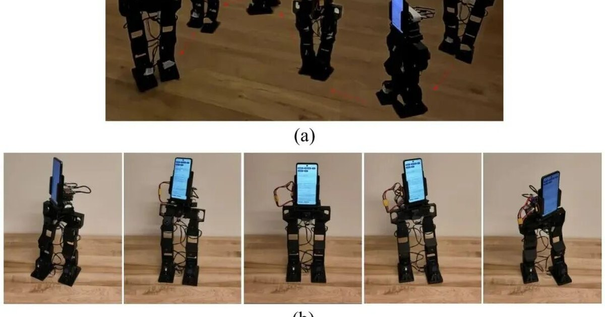

<h3 align="center"><strong>05. PhoneBot</strong></h3>

<table width="100%">
  <tbody>
    <tr>
      <td><strong>Summary</strong></td>
      <td>A low-cost open humanoid platform from the RoMeLa lab at UCLA that treats an ordinary Android smartphone as the torso-mounted hub for perception, computation and interaction, with a 13-servo lower body for walking and visual following.</td>
    </tr>
    <tr>
      <td><strong>Features</strong></td>
      <td>Paper-reported: 48.3 cm tall, about 1.8 kg including the phone, 13 actuated joints, roughly 400 USD in hardware cost excluding the phone. The phone supplies the camera, IMU, wireless connectivity and on-board processing, so no separate sensors or computer are needed. Commands travel over Wi-Fi to a small on-board single-board computer that drives the servos. Locomotion policies are trained with reinforcement learning with explicit handling of the servo torque limit.</td>
    </tr>
    <tr>
      <td><strong>Hardware   plan</strong></td>
      <td>13 × DYNAMIXEL XL430-W250-T servos, one commodity Android smartphone, a small on-board single-board computer, a USB-to-TTL U2D2 interface, a 3S battery with a DC converter, modular linkage and torso structure. The current version has no arms.</td>
    </tr>
    <tr>
      <td><strong>GitHub   link</strong></td>
      <td>No publicly accessible official GitHub repository could be verified. Official project page: <a href="https://phonebot.dev/">phonebot.dev</a></td>
    </tr>
  </tbody>
</table>

Related resources: [Paper arXiv:2610.08737](https://arxiv.org/abs/2610.08737)

  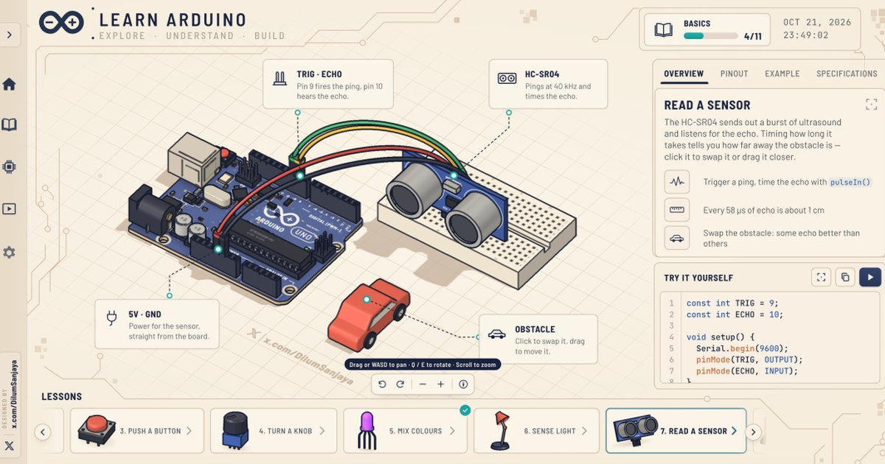

<h3 align="center"><strong>06. Learn Arduino</strong></h3>

<table width="100%">
  <tbody>
    <tr>
      <td><strong>Summary</strong></td>
      <td>An interactive 3D Arduino course in the browser: drag wires, place components and edit code on a virtual board, then watch simulated LED, servo and sensor feedback.</td>
    </tr>
    <tr>
      <td><strong>Features</strong></td>
      <td>Rotatable 3D board views with pins and wires laid out by circuit connection so miswiring is visible immediately. Code can be edited and run in place, with a serial monitor. 16 progressive lessons run from blinking an LED, buttons and potentiometers through ultrasonic sensing, servos and stepper motors, ending in an obstacle-avoiding traffic light project. Simulation cannot reproduce loose contacts or under-voltage.</td>
    </tr>
    <tr>
      <td><strong>Hardware   plan</strong></td>
      <td>No hardware required — a purely browser-based 3D circuit simulation and course. No download or installation needed.</td>
    </tr>
    <tr>
      <td><strong>GitHub   link</strong></td>
      <td>No official GitHub source repository could be verified. Use online: <a href="https://learn-arduino-red.vercel.app/">learn-arduino-red.vercel.app</a></td>
    </tr>
  </tbody>
</table>

Related resources: designed by <a href="https://x.com/DilumSanjaya">Dilum Sanjaya</a> (independent project, not an official Arduino product).

  

<h3 align="center"><strong>07. Dummy-Robot</strong></h3>

<table width="100%">
  <tbody>
    <tr>
      <td><strong>Summary</strong></td>
      <td>A super-compact desktop robotic arm open-sourced by Zhihui Jun (peng-zhihui), driven by stepper motors and reducers, with forward and inverse kinematics, CAN bus control and a wireless teach pendant — industrial-grade arm kinematics squeezed into desktop size.</td>
    </tr>
    <tr>
      <td><strong>Features</strong></td>
      <td>Computes forward kinematics from joint angles to end-effector pose and inverse kinematics, picking the solution with the smallest joint change from the previous pose out of up to 8 candidates. Trapezoidal acceleration with CAN broadcast sync starts and stops all six joints together. Three command modes: SEQ for low-frequency sequential moves, INT for interruptible real-time control, and TRJ for fixed-period trajectory interpolation. The core firmware moved from LiteOS to FreeRTOS and the kinematics are open source, so swapping DH parameters ports it to a custom arm. Ships with the Peak wireless teach pendant and the DummyStudio host app.</td>
    </tr>
    <tr>
      <td><strong>Hardware   plan</strong></td>
      <td>The original uses aluminium CNC structure with 20/42 stepper motors and harmonic reducer modules, built from four core boards: REF core board, REF base board, stepper driver board and the Peak teach pendant. Drivers use integrated closed-loop control over CAN, so each axis needs only two power wires and two CAN wires. The author recommends the upcoming budget version for cost-sensitive builders: 3D-printed structure with self-made cycloidal reducers replacing the harmonic ones, targeting under 2000 CNY for the whole unit.</td>
    </tr>
    <tr>
      <td><strong>GitHub   link</strong></td>
      <td><a href="https://github.com/peng-zhihui/Dummy-Robot">peng-zhihui/Dummy-Robot</a></td>
    </tr>
  </tbody>
</table>

Related resources: introduction videos on Bilibili and YouTube (search "稚晖君 robotic arm").

  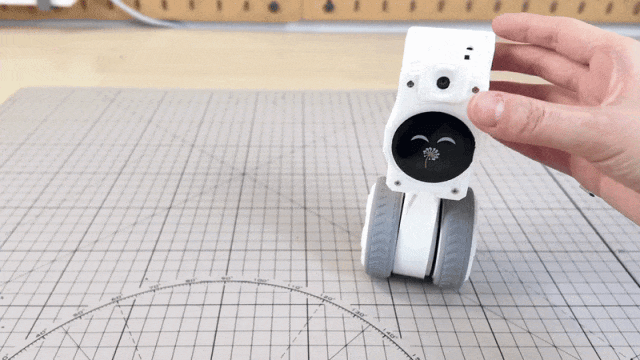

<h3 align="center"><strong>08. RIG-Hover</strong></h3>
<table width="100%">
<tbody>
<tr>
<td>
<strong>Summary</strong>
</td>
<td>
An open-source, ESP32-S3-based desktop robot with two-wheel
self-balancing, dynamic expressions, voice interaction, and visual
perception.
</td>
</tr>
<tr>
<td>
<strong>Features</strong>
</td>
<td>
Supports self-balancing, animated expressions on an LCD, voice
interaction, face detection, and Bluetooth gamepad control.
</td>
</tr>
<tr>
<td>
<strong>Hardware</strong>
</td>
<td>
ESP32-S3, QMI8658C six-axis IMU, FOC brushless motors, circular LCD,
head servo, camera, I2S digital microphone, and a 3D-printed enclosure.
</td>
</tr>
<tr>
<td>
<strong>GitHub</strong>
</td>
<td>
<a href="https://github.com/LuwuDynamics/rig_omni">LuwuDynamics/rig_omni</a>
</td>
</tr>
</tbody>
</table>

Related resources: [Official
Documentation](https://wiki.xgorobot.com/kb/pet-hover) · [3D-Printable
Model](https://makerworld.com/en/models/2909205) · [Flashing
Tool](https://tools.luwudynamics.ai)

  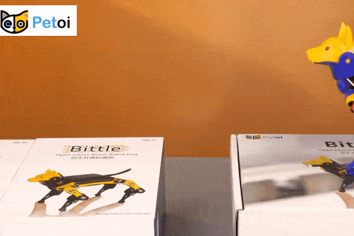

<h3 align="center"><strong>09. OpenCat / Bittle X</strong></h3>

</h3>
<table width="100%">
<tbody>
<tr>
<td>
<strong>Summary</strong>
</td>
<td>
A quadruped robot based on the open-source OpenCat framework. It
supports motion programming and locomotion control, making it suitable
for getting started with robotics hardware and software.
</td>
</tr>
<tr>
<td>
<strong>Features</strong>
</td>
<td>
Supports walking, running, turning, and predefined actions. Motions can
be modified using visual programming, C/C++, or Python. Cameras,
Raspberry Pi, or Jetson computers can be added for further vision and
voice capabilities.
</td>
</tr>
<tr>
<td>
<strong>Hardware</strong>
</td>
<td>
Bittle X robot kit, ESP32 control board, joint servos, and an IMU. A
camera, Raspberry Pi, or Jetson computer can be added as an extension.
The exact configuration depends on the kit version.
</td>
</tr>
<tr>
<td>
<strong>GitHub</strong>
</td>
<td>
<a href="https://github.com/PetoiCamp/OpenCatEsp32-Quadruped-Robot">OpenCatESP32-Quadruped-Robot</a>
</td>
</tr>
</tbody>
</table>

<table width="100%">
<tr>
<td align="center" width="33%">
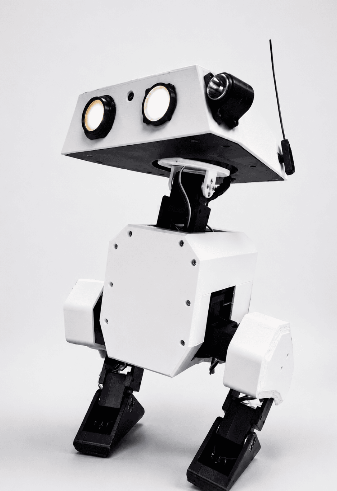
</td>
<td align="center" width="33%">
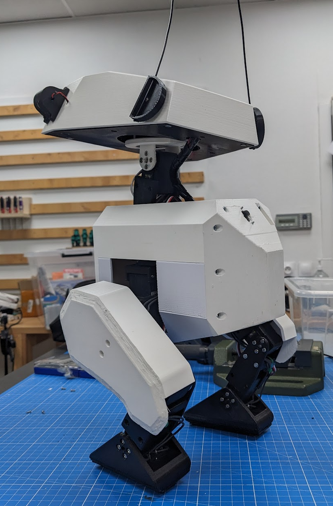
</td>
<td align="center" width="33%">
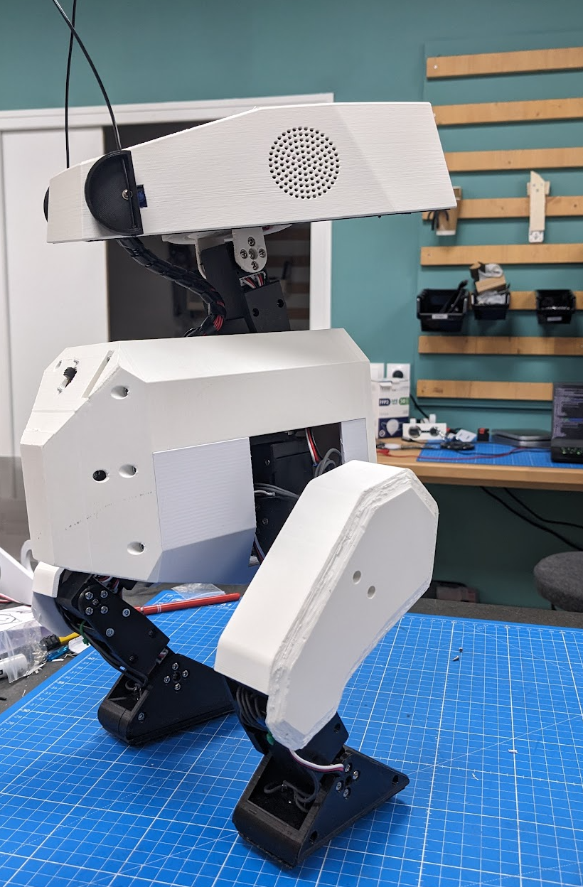
</td>
</tr>
</table>
<h3 align="center">
<strong>10. Open Duck Mini v2</strong>
</h3>
<table width="100%">
<tbody>
<tr>
<td>
<strong>Summary</strong>
</td>
<td>
An open-source small bipedal robot for locomotion and reinforcement
learning research. Walking policies are trained in simulation and then
deployed on the physical robot.
</td>
</tr>
<tr>
<td>
<strong>Features</strong>
</td>
<td>
Supports standing, forward and backward movement, lateral movement, and
turning. Walking policies can be trained in MuJoCo-related simulation
environments and deployed to the real robot through workflows such as
ONNX, making it useful for learning bipedal control and sim-to-real
transfer.
</td>
</tr>
<tr>
<td>
<strong>Hardware</strong>
</td>
<td>
3D-printed structural parts, serial bus servos, Raspberry Pi Zero 2 W,
IMU, power system, and wiring. Check the official repository for the BOM
and exact component models for the relevant version.
</td>
</tr>
<tr>
<td>
<strong>GitHub</strong>
</td>
<td>
<a href="https://github.com/apirrone/Open_Duck_Mini/tree/v2">Open Duck
Mini v2</a>
</td>
</tr>
</tbody>
</table>

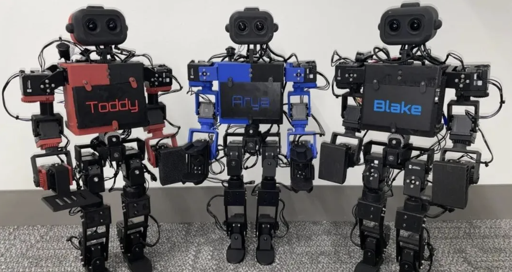

<h3 align="center">
<strong>11. ToddlerBot 2.0</strong>
</h3>
<table width="100%">
<tbody>
<tr>
<td>
<strong>Summary</strong>
</td>
<td>
An open-source humanoid robot platform for robot learning, whole-body
locomotion, and manipulation research, with tools for simulation,
teleoperation, reinforcement learning, and vision-based manipulation.
</td>
</tr>
<tr>
<td>
<strong>Features</strong>
</td>
<td>
Supports omnidirectional walking, whole-body motions, and bimanual
manipulation tasks. The toolchain includes MuJoCo simulation,
reinforcement learning, keyframe motions, whole-body teleoperation, and
vision-based manipulation policies.
</td>
</tr>
<tr>
<td>
<strong>Hardware</strong>
</td>
<td>
3D-printed structural parts, Dynamixel servos, a Jetson computing
platform, custom power and communication PCBs, cameras, and wiring.
Check the official documentation for the configuration of the relevant
version.
</td>
</tr>
<tr>
<td>
<strong>GitHub</strong>
</td>
<td>
<a href="https://github.com/hshi74/toddlerbot">ToddlerBot Code and
Documentation</a>
</td>
</tr>
</tbody>
</table>

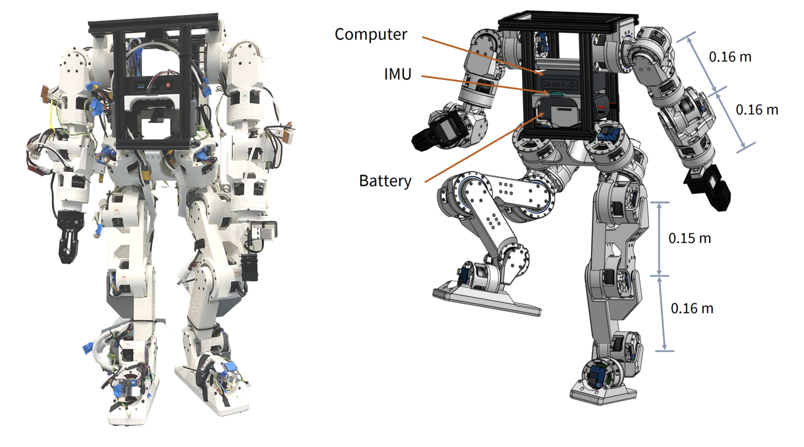

<h3 align="center">
<strong>12. Berkeley Humanoid Lite V1</strong>
</h3>
<table width="100%">
<tbody>
<tr>
<td>
<strong>Summary</strong>
</td>
<td>
An open-source humanoid robotics platform providing mechanical designs,
actuator designs, low-level control, and reinforcement learning tools
for studying humanoid system integration.
</td>
</tr>
<tr>
<td>
<strong>Features</strong>
</td>
<td>
Supports reinforcement-learning-based locomotion and teleoperated
grasping. Resources include CAD, low-level control, robot models, Isaac
Lab training, and real-robot deployment.
</td>
</tr>
<tr>
<td>
<strong>Hardware</strong>
</td>
<td>
Brushless motors, modular 3D-printed cycloidal reducers, joint motor
controllers, CAN bus, IMU, and onboard computing. Check the BOM for the
exact V1 actuator and controller configuration.
</td>
</tr>
<tr>
<td>
<strong>GitHub</strong>
</td>
<td>
<a href="https://github.com/HybridRobotics/Berkeley-Humanoid-Lite">Berkeley
Humanoid Lite</a>
</td>
</tr>
</tbody>
</table>

 

## 🤖 More Robot Projects

 

### 🦾 1. Robot Systems & Open-Source Hardware

Covers humanoid, quadruped, robotic arm, and mobile robot projects,
along with related hardware resources.

#### Humanoid Robots

- **[AgiBot X1](https://github.com/AgibotTech/agibot_x1_infer)** —
  [Inference](https://github.com/AgibotTech/agibot_x1_infer) ·
  [Training](https://github.com/AgibotTech/agibot_x1_train) ·
  [Hardware](https://github.com/AgibotTech/agibot_x1_hardware)  
  📄 An open-source humanoid robot project featuring inference modules,
  reinforcement learning training code, and comprehensive hardware
  design resources.

- **[OpenLoong Qinglong](https://github.com/loongOpen)**  
  📄 A full-stack open-source humanoid robot project covering dynamics
  control (MPC + WBC), hardware design, training platforms, and skill
  scheduling frameworks.

- **[Fourier N1](https://github.com/FFTAI)**  
  📄 A humanoid robot project by Fourier Intelligence, providing
  hardware designs, BOM, assembly guides, and the Fourier-GRX SDK.

- **[EngineAI
  Humanoid](https://github.com/engineai-robotics/engineai_humanoid)**  
  📄 Open-source locomotion control algorithms for EngineAI’s SA01/PM01
  bipedal robots, using end-to-end neural networks to achieve human-like
  walking.

- **[Unitree Qmini](https://github.com/unitreerobotics/Qmini)**  
  📄 An open-source bipedal robot platform from Unitree Robotics, with
  BOM, assembly guides, the RoboTamer4Qmini control framework, and URDF
  models.

- **[K-Bot](https://github.com/kscalelabs/kbot)**  
  📄 A full-stack open-source humanoid robot platform for developers and
  researchers.

#### Quadruped Robots

- **[OpenCat](https://github.com/PetoiCamp/OpenCat)** ⭐ 15k  
  📄 An open-source quadruped robot platform.

- **[Xiaomi
  CyberDog](https://github.com/MiRoboticsLab/cyberdog_ros2)**  
  📄 Open-source software and hardware resources for Xiaomi’s CyberDog
  quadruped robot.

- **[Unitree Quadruped
  ROS](https://github.com/unitreerobotics/unitree_ros)**  
  📄 ROS driver packages for Unitree Go1/Go2 quadruped robots.

#### Robotic Arms & Desktop Robots

- **[vlm_arm](https://github.com/TommyZihao/vlm_arm)**  
  📄 An open-source project combining robotic arms, large language
  models, and multimodal technologies.

- **[Dummy-Robot](https://github.com/peng-zhihui/Dummy-Robot)**  
  📄 A DIY mini robotic arm project by Zhihui Jun.

- **[ElectronBot](https://github.com/peng-zhihui/ElectronBot)**  
  📄 A compact desktop robot project by Zhihui Jun.

- **[Rubik’s Cube Solving
  Robot](http://www.diy-robots.com/?page_id=46)**  
  📄 A LEGO-based Rubik’s Cube solving robot project.

#### Mobile Robots

- **[MiniRover](https://github.com/peng-zhihui/MiniRover-Hardware)**  
  📄 Open-source resources for a DIY Mars rover by Zhihui Jun.

- **[ONE-Robot](https://github.com/peng-zhihui/ONE-Robot)**  
  📄 A self-balancing unicycle robot based on an IMU and STM32.

------------------------------------------------------------------------

 

### 👁️ 2. Perception & Manipulation Algorithms

Covers SLAM, sensor fusion, visual perception, grasping algorithms, and
related sensor resources.

#### SLAM & Perception

- **[Visual SLAM: A 14-Lecture
  Course](https://github.com/gaoxiang12/slambook2)** ⭐ 12k  
  📄 A classic Chinese-language SLAM tutorial with accompanying code by
  Gao Xiang.

- **[VINS-Mono](https://github.com/HKUST-Aerial-Robotics/VINS-Mono)** ⭐
  5k  
  📄 A robust monocular visual-inertial state estimator developed at the
  Hong Kong University of Science and Technology.

- **[VINS-Fusion](https://github.com/HKUST-Aerial-Robotics/VINS-Fusion)**  
  📄 An optimization-based multi-sensor state estimator supporting
  monocular and stereo cameras with IMU fusion.

- **[LIO-SAM](https://github.com/TixiaoShan/LIO-SAM)** ⭐ 3.5k  
  📄 A tightly coupled LiDAR-inertial odometry and mapping system.

- **[FAST_LIO](https://github.com/hku-mars/FAST_LIO)** ⭐ 2.5k  
  📄 An efficient and robust LiDAR-inertial odometry framework from the
  HKU MARS Lab.

- **[FAST-LIVO2](https://github.com/hku-mars/FAST-LIVO2)**  
  📄 A tightly coupled LiDAR-inertial-visual odometry system.

- **[R3LIVE](https://github.com/hku-mars/r3live)** ⭐ 2.0k  
  📄 A real-time RGB-colored LiDAR-inertial-visual localization and
  mapping system.

- **[Unitree 4D LiDAR
  SLAM](https://github.com/unitreerobotics/point_lio_unilidar)**  
  📄 A Point-LIO-based SLAM solution adapted for Unitree’s L1 4D LiDAR.

#### Grasping & Manipulation

- **[AnyGrasp](https://github.com/graspnet/anygrasp_sdk)**  
  📄 A general-purpose 6-DoF grasp pose estimation algorithm for robotic
  grasp detection.

- **[MYNT-EYE Stereo Camera
  SDK](https://github.com/slightech/MYNT-EYE-S-SDK)**  
  📄 SDK resources for MYNT-EYE stereo cameras, supporting vision and
  SLAM development.

------------------------------------------------------------------------

### 🧠 3. Embodied Models & Platform Toolchains

Covers VLA manipulation models, conversational agents, embodied AI
platforms, and no-code robot development tools.

#### Embodied Models

- **[GR-1 (ByteDance Model)](https://github.com/bytedance/GR-1)**  
  📄 A GPT-style vision-based robot manipulation model from ByteDance
  for language-conditioned, multi-task manipulation learning and action
  prediction. Do not confuse it with AgiBot’s GR-1 humanoid robot.

#### Platforms & Toolchains

- **[X-Humanoid: Husi Kaiwu](https://open.x-humanoid-cloud.com/)**  
  📄 An embodied AI toolchain platform covering skill invocation, agent
  configuration, and scenario deployment.

- **[Agibot LinkCraft](https://www.agibot.com.cn/filepage/295.html)**  
  📄 A no-code robot content creation platform supporting motion
  imitation, voice-driven interaction, and task script generation.

- **[Tencent Tairos](https://tairos.tencent.com/)**  
  📄 An embodied AI platform providing models, development tools, and
  data services for robotics applications.

- **[Viam](https://www.viam.com/)**  
  📄 A software platform for building, deploying, and managing robots,
  with unified APIs, module registration, remote operations, and fleet
  management.

- **[JD JoyInside](https://joyinside.com/)**  
  📄 A conversational AI agent platform for robots and AI-enabled smart
  devices.

- **[NetEase Lingdong ·
  Lingjue](https://lingdong.fuxi.163.com/productSummary/wj)**  
  📄 An embodied AI model and training framework for excavator loading
  operations in mining scenarios.

------------------------------------------------------------------------

### 🛠️ 4. Data, Training & Teleoperation

Covers reinforcement learning, imitation learning, data collection,
teleoperation systems, and robotics tutorials.

#### Learning & Training Frameworks

- **[Booster Gym](https://github.com/BoosterRobotics)**  
  📄 An end-to-end reinforcement learning locomotion framework for
  Booster T1/K1 humanoid robots, including a RoboCup autonomous soccer
  demo.

- **[Humanoid-Gym](https://github.com/roboterax/humanoid-gym)**  
  📄 An Isaac Gym-based reinforcement learning framework for humanoid
  robots, supporting zero-shot transfer to real robots.

- **[OpenR1-Multimodal](https://github.com/EvolvingLMMs-Lab/open-r1-multimodal)**
  ⭐ 1.5k  
  📄 Explores applying the R1 reasoning paradigm to multimodal models
  and provides multimodal reinforcement learning training samples.

- **[unitree_rl_gym](https://github.com/unitreerobotics/unitree_rl_gym)**  
  📄 Unitree’s reinforcement learning framework for quadruped and
  humanoid robots, based on Isaac Gym.

- **[unitree_rl_lab](https://github.com/unitreerobotics/unitree_rl_lab)**
  · [MuJoCo
  Version](https://github.com/unitreerobotics/unitree_rl_mjlab)  
  📄 Unitree robot reinforcement learning implementations based on Isaac
  Lab and MuJoCo.

- **[unitree_IL_lerobot](https://github.com/unitreerobotics/unitree_IL_lerobot)**  
  📄 An imitation learning tool based on LeRobot for training and
  testing Unitree G1 dual-arm and dexterous-hand tasks.

#### Data Collection & Teleoperation

- **[ALOHA 2](https://aloha-2.github.io/)**  
  📄 A low-cost open-source hardware platform for bimanual teleoperation
  and embodied data collection, with tutorials and MuJoCo simulation
  models.

- **[DexCap](https://dex-cap.github.io/)**  
  📄 A Stanford-developed dexterous manipulation data collection system
  using hand motion capture and depth cameras to collect human
  manipulation data.

- **[Dobb-E](https://dobb-e.com/)**  
  📄 An NYU-developed home robotics data collection and imitation
  learning solution, including low-cost handheld collection hardware,
  datasets, and a learning framework.

- **[Unitree XR
  Teleoperation](https://github.com/unitreerobotics/xr_teleoperate)**  
  📄 An XR-based teleoperation system for Unitree H1/G1 humanoid robots,
  supporting devices such as Apple Vision Pro and Meta Quest.

#### Tutorials & Knowledge Bases

- **[RoboWiki](https://github.com/yfrobotics/robowiki)**  
  📄 A robotics knowledge base maintained by Yunfei Robotics Lab.

- **[Unitree Robotics Control
  Tutorial](https://github.com/unitreerobotics/unitree_guide)**  
  📄 An open-source tutorial for Unitree quadruped robot control,
  suitable for beginners and reference.

[↑ Back to Contents](#toc)

<!-- Retained for compatibility with existing links. -->

