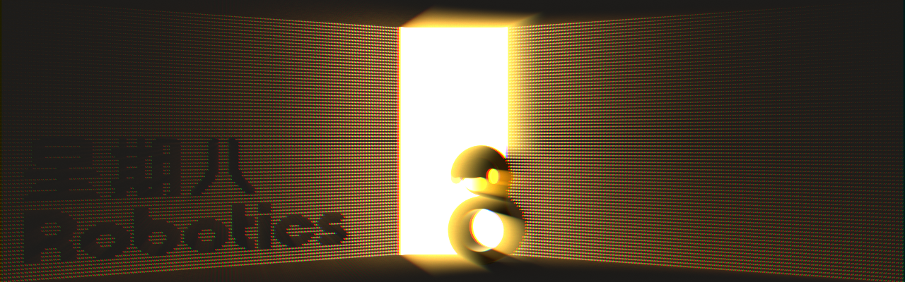
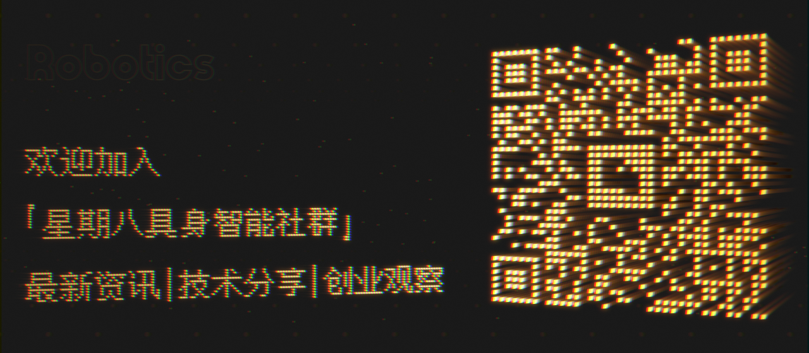

  <h1>Embodied AI Knowledge Index & Industry Map</h1>

  

  🌐 <a href="../README.md">中文版</a>

  
  
  

  Connecting frontier research, open-source engineering, and industrial applications to build an accessible resource hub for embodied AI developers and explorers.

---

## 🧭 Where to Start

**Looking for code and open-source resources? Explore GitHub. Looking for technical insights and industry knowledge? Visit the Octoday Hub Knowledge Base.**

We organize open-source technical resources and knowledge content separately, helping developers quickly find tools they can use while enabling learners to explore embodied AI more systematically.

| 💻 GitHub · Open-Source Resource Hub | 📚 Feishu · Octoday Hub Knowledge Base |
| :---: | :---: |
| **For developers and researchers** | **For learners and industry explorers** |
| Open-source projects, code implementations, development tools, datasets, models, and demos | Research insights, technical tutorials, industry news, company profiles, and career resources |
| **[🚀 Explore Open-Source Resources ↓](#open-source-resources)** | **[📖 Visit the Octoday Hub Knowledge Base ↗](https://icn3nzefme8n.feishu.cn/wiki/HNtGwSt9bi0LXWkuV1vcGmbynRb)** |

---

## 🚀 Explore Open-Source Resources

**From frontier models to real-world robotics, and from development tools to training datasets.**

We continuously curate open-source resources from the global embodied AI community, prioritizing official code repositories, project documentation, dataset downloads, model weights, and demo links.

### 🤖 01 | Open-Source Projects

**Discover embodied AI projects worth reproducing, deploying, and building upon.**

| Category | What You'll Find | Explore |
| :--- | :--- | :--- |
| **Robot Systems & Open Hardware** | Humanoid robots, quadrupeds, robotic arms, open-source control systems, and hardware designs | [Robot Projects ↗](04-tools_EN.md#-robot-projects) |
| **Embodied Models & Code** | Vision-Language-Action (VLA) models, robotics foundation models, manipulation policies, and open model weights | [Open-Source Models ↗](04-tools_EN.md#-models) |
| **Robot Learning & Training** | Imitation learning, reinforcement learning, policy training, and deployment frameworks | [Learning Frameworks ↗](04-tools_EN.md#-learning-frameworks) |

**[Explore All Open-Source Projects & Models →](04-tools_EN.md)**

### 🛠️ 02 | Open-Source Tools

**Find the right tools for robotics development, training, simulation, and deployment.**

| Category | What You'll Find | Explore |
| :--- | :--- | :--- |
| **Simulation Platforms** | Physics engines, robotic simulators, virtual environments, and Sim2Real tools | [Simulation Platforms ↗](04-tools_EN.md#-simulation-platforms) |
| **General Tools & Libraries** | Robotics utilities, data processing tools, development libraries, and policy implementations | [General Tools ↗](04-tools_EN.md#-general-tools--libraries) |
| **SLAM & Perception** | Localization, mapping, 3D perception, and spatial understanding tools | [SLAM & Perception ↗](04-tools_EN.md#-slam--perception) |
| **ROS & Middleware** | ROS ecosystem tools, communication frameworks, and robotics system integration | [ROS Toolchains ↗](04-tools_EN.md#-middleware--ros-tools) |

**[Explore All Open-Source Tools & Frameworks →](04-tools_EN.md)**

### 📦 03 | Datasets

**Discover essential resources for robot training, data generation, and benchmark evaluation.**

| Data Category | Representative Resources | Typical Applications |
| :--- | :--- | :--- |
| **Real-World Robot Manipulation** | DROID, Open X-Embodiment, AgiBot World | Robot manipulation, VLA training, cross-embodiment generalization |
| **Teleoperation & Demonstration Data** | RH20T, ALOHA, UMI | Imitation learning, teleoperation, dexterous manipulation |
| **Simulation & Synthetic Data** | MimicGen, RoboCasa, RoboTwin | Data generation, policy training, Sim2Real |
| **Benchmarks & Evaluation** | LIBERO, RLBench, BEHAVIOR-1K | Multi-task learning, policy evaluation, algorithm comparison |

**[Explore the Full Dataset Index & Official Access Links →](06-datasets_EN.md#index)**

> 💡 **Resource Curation Principles:** We prioritize accessible official repositories, documentation, model weights, datasets, and demo links. Availability, licensing, and usage restrictions are subject to the original resource providers.

---

## 🎯 Our Vision

We hope to build an open knowledge gateway for embodied AI. Whether you work in a research laboratory or on the factory floor, we believe every spark of curiosity and every hands-on effort deserves a place in this shared landscape.

### 🌌 Why "Octoday"?

Beyond the conventional seven-day cycle, **"Octoday" represents an additional space for exploration — one that challenges established boundaries and embraces new possibilities.**

- **An Extra Perspective:** Beyond the rigor of academic research, we offer pragmatic insights into real-world industrial applications.
- **A Deeper Understanding:** Beyond algorithmic reasoning, we cultivate a deeper respect for the laws of the physical world.
- **An Alternative Path:** Beyond the pressures of competition, we hope to open a focused and accessible path for learning and growth.

We hope this community can become the clearest and most reliable point of reference as you explore the world of embodied AI.

Beyond the 7th Day, explore the Infinite Embodiment.

---

## 📍 Getting Started | From Understanding to Practice

Embodied AI refers to intelligent systems that perceive, understand, make decisions, and act through physical interaction with their environments. It brings together computer vision, reinforcement learning, and multimodal foundation models.

**If you are new to embodied AI, follow this learning journey to explore the field step by step.**

### 🪜 Stage One: Build Your Foundations

**Foundation Building → Frontier Watchtower**

Start with robotics, reinforcement learning, and computer vision. Then gradually explore frontier research in embodied foundation models, robot manipulation, and spatial intelligence.

### 🔧 Stage Two: Learn by Building

**Engineering Practice → Datasets**

Move from research to implementation. Choose suitable simulation platforms, open-source frameworks, robotics projects, and training datasets to reproduce algorithms, run demos, and develop your own technical projects.

### 🔗 Stage Three: Connect with Industry

**Industry Landscape → Career Development**

Explore the global embodied AI ecosystem, understand how technologies are applied in real-world scenarios, and identify opportunities for personal growth through industry needs and career pathways.

> 📌 **Learning & Development Resources**
>
> - **Open-source code, development tools, and datasets:** Explore the [Open-Source Resource Directory](#open-source-resources) above.
> - **Research papers, courses, companies, and career resources:** Browse the [Additional Resources](#more-resources) below or visit the [Octoday Hub Knowledge Base](https://icn3nzefme8n.feishu.cn/wiki/HNtGwSt9bi0LXWkuV1vcGmbynRb).

---

## 📚 Additional Resources

Beyond open-source technical resources, we have also curated research papers, learning materials, academic events, industry information, and career resources for further exploration.

Existing collections remain accessible on GitHub. For more research insights, technical tutorials, and industry news, visit the **[📖 Octoday Hub Knowledge Base ↗](https://icn3nzefme8n.feishu.cn/wiki/HNtGwSt9bi0LXWkuV1vcGmbynRb)**.

| Resource | Overview | Explore |
| :--- | :--- | :--- |
| **📄 Research Papers** | Embodied foundation models, manipulation, navigation, Sim2Real, and related research | [Paper Collection →](03-papers_EN.md) |
| **📖 Books & Courses** | Recommended books, online courses, and foundational embodied AI knowledge | [Learning Resources →](00-basics_EN.md) |
| **🎓 Conferences & Competitions** | International academic conferences, robotics competitions, and research events | [Research & Competition Hub →](05-research-hub_EN.md) |
| **🏭 Companies & Industry** | Embodied AI companies, robotics businesses, and the global industry ecosystem | [Company Directory →](01-companies_EN.md) |
| **🎒 Jobs & Careers** | Full-time positions, internships, graduate recruitment, and career opportunities | [Job Opportunities →](02-jobs_EN.md) |

> 📌 **Update Note:** Some of these resources will gradually be maintained primarily in the Feishu Knowledge Base. Existing GitHub pages and links will remain accessible for reference. Please check the original publication dates when consulting historical content.

---

## 🌱 Community Contributions

We welcome every developer, researcher, and embodied AI enthusiast to contribute.

Whether you are recommending new open-source projects, adding development tools and datasets, fixing broken links, or improving resource categories, your contributions help make this resource map more useful and accessible.

- 📖 [Contribution Guidelines](CONTRIBUTING_EN.md): Learn how to participate and submit resources.
- ✨ [Pull Requests](https://github.com/Octoday-Hub/Embodied-AI/pulls): Submit open-source resources and content updates.
- 🐛 [Issues](https://github.com/Octoday-Hub/Embodied-AI/issues): Recommend resources, report issues, or share suggestions.

**Update Schedule:** We plan to curate resources, verify links, and submit updates every Tuesday and Friday, focusing on open-source projects, development tools, and datasets. Please refer to the GitHub commit history for actual changes.

We appreciate every contribution and look forward to growing this community together.

---

## 👥 About Octoday Hub

Octoday Hub is an open community of embodied AI enthusiasts, developers, and industry observers. Through systematic resource curation, we aim to lower the barriers to entering embodied AI, accelerate knowledge sharing, and bridge research with industrial applications.

If you have ideas, resource recommendations, or collaboration inquiries, feel free to contact us:

📧 Email: [octoday@yeah.net](mailto:octoday@yeah.net)

💬 WeChat: Midsummer_Jin

📱 WeChat Official Account: 星期八Robotics (Octoday Robotics)

*Scan the QR code below for community updates and resources.*

---

## 🌟 Star This Repository

If you find this repository helpful, feel free to Star ⭐️ or Fork it, and share it with fellow developers and researchers.

Your support motivates us to keep improving the resource collection.

## 📄 License

The content of this project is licensed under [CC BY-NC-SA 4.0](https://creativecommons.org/licenses/by-nc-sa/4.0/).

Third-party code, models, datasets, and other open-source projects are subject to their respective licenses and terms of use.
